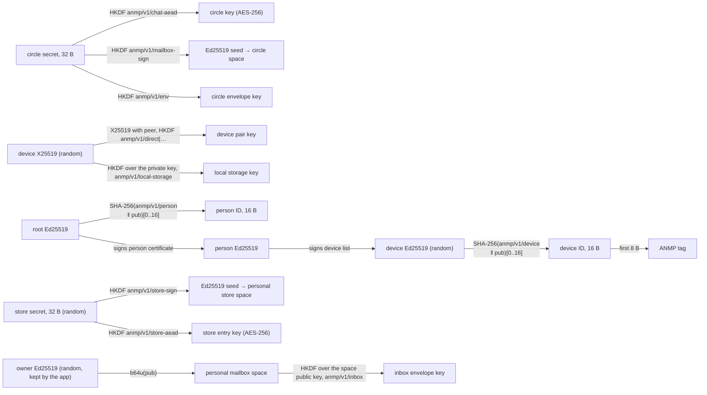

# ANMP – anynear Message Protocol, version v1

ANMP is the one message format of anynear for every path (internet, radio, later others). A path only carries
bytes; paths differ in limits, never in structure. This document describes the format layer: packet, CBOR,
kinds, encryption, signature, key derivation and identifiers, and in [Core on ANDP](#core-on-andp) how the core
stores packets and blobs in ANDP (spaces, placement, grants, links).

Schema: [`anmp.cddl`](anmp.cddl). Test vectors: [`../vectors/anmp-v1.json`](../vectors/anmp-v1.json).
Reference implementation: `kotlin/format` (package `app.anynear.anmp`); the radio part also in Go
(`go/anmp`, module `github.com/anynear/ANMP/go`, for a radio bridge in a relay).

Status: version v1, in use in the anynear apps since November 2026. What v1 protects and what it does not is in
[Security considerations](#security-considerations). ANMP stores its packets in ANDP (anynear
Distributed Protocol, repository `anynear/ANDP`); "ANDP §n" refers to that specification. "ADR nnnn" refers to an
internal decision record of the project; the records are not part of this repository, and every rule that follows
from one is stated here in full.

ANMP v1 replaced the format of an earlier version of the app (ADR 0061 decision 5): same structure, new values (magic `41 4E 01`, alerts
`41 41 01`, device address records `41 49 01`, HKDF salt `anmp`, labels `anmp/v1/…`, radio channel `anynear`).
Version v1 constants never change; apps update, they are not reinstalled (ADR 0061 decision 13). An incompatible
change gets `anmp/v2/…` and runs next to v1 until no app in use speaks only v1.

## Conventions

| Term | Meaning |
|---|---|
| HKDF(secret, info) | HKDF-SHA256, salt `anmp` (4 ASCII bytes), info as UTF-8, 32 bytes output |
| AEAD | AES-256-GCM, 12-byte nonce, 16-byte tag; sealed form `nonce ‖ ciphertext ‖ tag` |
| b64u | Base64url without padding |
| `‖` | concatenation; texts are UTF-8, `\n` is byte 0x0A |

## Frame

```
packet bytes = 41 4E 01 ‖ CBOR(packet)
packet       = [ h: bstr(CBOR header), b: bstr(sealed) ]
b            = AEAD(key, CBOR(inner), AAD)
inner        = [ c: bstr(CBOR content) ]   or   [ c, s: bstr(64) ]
opened       = [ h, c ]                    or   [ h, c, s ]
```

- **Magic** `41 4E 01` ("AN", version v1). The third byte is the only version field; there is no negotiation.
  A packet must be longer than 3 bytes and start with exactly these bytes.
- **Embedded CBOR:** `h` and `c` are byte strings. AAD and signature cover exactly the transmitted bytes, so no
  canonical form is needed to verify.
- **Encoding rules for writers:** integer keys, definite lengths, all byte data as `bstr`, default values
  omitted (`null`, `0`, `false`, empty), keys ascending. Without signature `inner` has one element.
- **Readers** skip unknown keys in header and content and drop packets with an unknown kind.
- **opened** is the packet without encryption. It is kept in the history (ADR 0014) and stays verifiable
  without the circle key.

## Header

| Key | Field | Type | Present | Content |
|---|---|---|---|---|
| 0 | kind | uint | always | see [Kinds](#kinds); unknown → drop |
| 1 | from | bstr 8 | always | ANMP tag of the sender |
| 2 | to | bstr 8 | direct | ANMP tag of the recipient |
| 3 | epoch | uint | circle, radio | circle key epoch (ADR 0012) |
| 4 | senderKey | bstr 32 | direct, internet | X25519 public key of the sender |
| 5 | senderDevice | bstr 16 | direct, internet | device ID of the sender |
| 6 | route | bstr 8 | radio | route tag of the recipient device or circle ([One radio channel](#one-radio-channel)) |
| 7 | since | uint | ask | Unix seconds: the asker has everything until about then |
| 8 | askTags | [* bstr 6] | never by a v1 sender | reserved: formerly shortened route tags of an `ask`. A v1 `ask` carries only fields 0, 1 and 7. Readers still parse the field (at most 8 tags of 6 bytes, otherwise the packet is invalid) and ignore it; the vectors keep an `ask` with it for that reason |
| 9 | waiting | uint | patron | packets the patron holds for the asker (optional) |
| 10 | hour | uint | pickup | hour up to which the pickup windows reach |

Wrong lengths of fields 1, 2, 4, 5, 6, 8 make the packet invalid. Which path sets which fields:

| Path and kind | Fields |
|---|---|
| internet, circle | 0, 1 |
| internet, to one installation | 0, 1, 2, 4, 5 |
| radio, circle message and circle reaction | 0, 1 (sender tag), 3, 6 |
| radio, direct, direct reaction, read receipt, receipt | 0, 1 (sender tag), 6 |
| radio, ask | 0, 1 (sender tag), 7 |
| radio, patron | 0, 1 (sender tag), 4 (one-time key of the patron), 9 (optional) |
| radio, pickup | 0, 1 (sender tag), 2 (first 8 bytes of the patron's one-time key), 4 (one-time key of the asker), 10 |

Over radio field 1 is the hourly sender tag, never the ANMP tag, and field 2 is never set (ADR 0051).

A direct packet without fields 4/5 found in a personal mailbox was forwarded from radio (ADR 0022) and is opened
like a radio packet.

## Content

All fields are optional; which are set depends on the kind.

| Key | Field | Type | Meaning | Radio |
|---|---|---|---|---|
| 0 | id | bstr 8 | message ID, random, the same on every path | yes |
| 1 | ts | uint | sender time, seconds | yes |
| 2 | text | tstr | text or attachment announcement | yes |
| 3 | ref | bstr 8 | message ID a reaction or deletion refers to, or the message a circle or direct message answers (ADR 0092) | yes |
| 4 | refFrom | bstr 8 | tag of its author | yes |
| 5 | emoji | tstr | reaction, `""` = withdrawn | yes |
| 6 | ids | [* bstr 8] | confirmed message IDs | yes |
| 7 | name | tstr | display name of the sender | no |
| 8 | key | bstr 32 | X25519 public key of the sender | no |
| 9 | signKey | bstr 32 | Ed25519 public key of the sender | no |
| 10 | node | uint | Meshtastic node number | circle and direct messages, if the text leaves room (ADR 0058) |
| 11 | attachments | [* attachment] | attachments | no |
| 12 | image | image | own picture | no |
| 13 | imageTs | uint, ms | time of the picture change | no |
| 14 | imageHash | bstr 16 | hash of the own picture | no |
| 15 | circleImageHash | bstr 16 | hash of the circle picture | no |
| 16 | meta | meta | circle name and picture | no |
| 17 | wantHash | bstr 16 | wanted hash (want/have) | no |
| 18 | haveRef | image | where the wanted item is | no |
| 19 | needsHistory | bool | new member needs the history | no |
| 20 | history | history | index of history parts | no |
| 21 | rekey | rekey | circle key change | no |
| 22 | removed | removed | "you were removed" | no |
| 23 | inbox | bstr 32 | space of the sender's personal mailbox, so the reader can answer | no |
| 24 | grant | bstr | ANDP grant (CBOR `[body, sig]`) to write into `inbox` | no |
| 25 | person | bstr | key chain of the sender's person, see [Persons and devices](#persons-and-devices-adr-0042) | no |
| 26 | peer | bstr 16 | person ID of the conversation partner, in copies for the own other devices | no |
| 27 | personRef | [n, seq] | state of the sender's key chain (certificate number, list number) | no |
| 28 | circle | tstr | circle ID of a read state for the own other devices | no |
| 29 | sync | sync | snapshot for the own other devices (kind sync) | no |
| 30 | keys | sync-keys | new private keys of the person for the own other devices (kind sync) | no |
| 31 | ownData | own-data | data of the app for the own other devices (kind sync) | no |
| 32 | arrived | uint | receipt: paths the confirmed messages arrived on, bit 0 internet, bit 1 radio; missing = not said (ADR 0058) | yes |
| 33 | channel | channel-ref | channel of a subscribe, unsubscribe or channel key (ADR 0062 §11) | no |
| 34 | link | link | preview of the first web link in field 2, made by the sender (ADR 0069) | no |
| 35 | alive | alive | sign of life (kind alive, ADR 0083 §5) | yes |
| 36 | care | care | answer of a helper to a sign of life (kind care, ADR 0083 §4) | yes |
| 37 | author | bstr 16 | device ID of the original sender in an own copy of a received direct, react or delete (ADR 0107) | no |
| 38 | passedOn | `true` | the sender passed on a message it got (ADR 0118); missing = not passed on | no |
| 39 | ask | bool | in `profile`: the sender asks to become a contact (ADR 0116 §7) | no |
| 40 | intro | intro | in `direct`: a contact introduced to the reader (ADR 0116 §2) | no |
| 41 | introReply | intro-reply | in `direct` without text: wants the introduced contact (to the introducer), or the request passed on (to the introduced person) (ADR 0116 §3) | no |
| 42 | place | place | what the sender shares of its place with the reader (kind position; also in a direct message, ADR 0121 §3, §20) | yes |
| 43 | spot | spot | in `circle` and `direct`: a meeting point, the question where the reader is, or the sender's place as the answer (ADR 0121 §8) | if it fits |
| 44 | sos | sos | a call for the helpers or a helper's answer to it (kind sos, ADR 0083 §2–§4) | yes |

Structures (see CDDL for types):

| Structure | Fields |
|---|---|
| attachment | 0 id (blob ID, 32) · 1 key 32 · 2 type `jpg`/`pdf`/`m4a`/`file` · 3 name? · 4 size · 5 width? · 6 height? · 7 hash 16? · 8 duration ms? · 9 transcribed? |
| | `file` (any other file, ADR 0041): unchanged bytes, field 3 name required (the receiver derives the media type from its extension); readers that do not know a type drop that attachment and keep the message |
| image | 0 id (blob ID, 32) · 1 key 32 · 2 from (space that holds the blob, 32) · 3 hash 16? |
| link | 0 url (`https://`, must appear in field 2, otherwise readers ignore the preview) · 1 title? (≤ 120) · 2 description? (≤ 200) · 3 site? (≤ 120) · 4 image? (attachment of type `jpg`, in the space of the message, not counted towards the attachment limit) |
| intro | 0 card (CBOR `[body, sig]` of intro-card, sig by the person key of `by` over `anmp/v1/intro\n` ‖ body) · 1 image? (attachment of type `jpg`, the picture of the introduced person, in the space of the message) |
| intro-card | 0 id 16 · 1 until s · 2 person (introduced, person ID 16) · 3 name (its own, ≤ 40) · 4 to (person ID 16) · 5 by (introducer, person ID 16) |
| intro-reply | 0 card (the signed card answered) · 1 contact (contact link `https://…/c#…` of the person `to`) |
| meta | 0 name · 1 nameTs ms · 2 nameBy 16 · 3 image? · 4 imageTs ms · 5 imageBy 16 · 6 places? · 7 placesTs ms? · 8 placesBy 16? |
| circle-place | 0 id 8 · 1 name (1–40 characters) · 2 lat · 3 lon (degrees × 10 000) · 4 radius m (1–5000) |
| alive | 0 plan (ID 8) · 1 state · 2 start s · 3 until s · 4 due s · 5 hint s · 6 alarm s · 7 quiet s · 8 motion? · 9 label (≤ 40)? · 10 battery %? · 12 position? (11 is reserved) · 13 guard? · 14 calls? · 15 watch (32)? |
| position | 0 lat (degrees × 10 000, north positive) · 1 lon (degrees × 10 000, east positive) · 2 at s (when the device located it) · 3 acc m? (accuracy) |
| care | 0 plan (ID 8) · 1 state (1 looking, 2 away, 3 back) |
| history | 0 circle · 1 count · 2 from ms? · 3 to ms? · 4 [* part]? |
| part | 0 id (blob ID, 32) · 1 key 32 · 2 from (space, 32) · 3 SHA-256 of the plaintext 32 · 4 delete token 32? (pre-ANDP, no longer written) · 5 grant? (ANDP delete grant scoped to the part) |
| rekey | 0 key 32 · 1 epoch · 2 removed device 16? · 3 why (`remove`/`reset`/`left`/`device`)? · 4 circle? · 5 ts ms? |
| removed | 0 epoch · 1 circle? · 2 ts ms? |
| sync | 0 ts ms · 1 name? · 2 [* sync-circle] · 3 [* sync-contact] · 4 [* gone] · 5 [* sync-channel]? · 6 [* sync-asked]? · 7 [* published link grant (wire form)]? |
| sync-asked | 0 person (person ID, or device ID from a contact link) · 1 name · 2 device? · 3 by (introducer)? · 4 ts ms · 5 until ms (ADR 0116) |
| sync-circle | 0 id · 1 name · 2 secret 32 · 3 epoch? · 4 epochTs ms? · 5 epochBy 16? |
| sync-contact | 0 name · 1 signKey 32 · 2 key 32 · 3 inbox 32? · 4 person proof? · 5 since ms? (when it became a contact; absent or 0 = unknown) |
| gone | 0 id (circle ID, person ID or channel ID) · 1 ts ms |
| sync-channel | 0 id (space, tstr) · 1 name · 2 private read key 32 · 3 read grant (wire form) · 4 joined ms? · 5 curated? · 6 owner seed 32? · 7 nameTs ms? · 8 keyTs ms? · 9 [* sync-ingress]? · 10 [* revoked device address ID]? · 11 [* sync-subscriber]? · 12 [* gone] (removed subscribers, device ID)? · 13 channel-join? |
| sync-subscriber | 0 device 16 · 1 name? · 2 key 32 · 3 inbox 32 · 4 grant (CBOR) · 5 since ms? · 6 ts ms? |
| channel-ref | 0 space (tstr) · 1 hash of the held read grant 32? (subscribe) · 2 new read key 32? · 3 new read grant (wire form)? · 4 owner signature 64? (channel key) |
| sync-ingress | 0 token 32 · 1 label? · 2 created ms? · 3 sender seed 32 · 4 sender grant (wire form) · 5 record entry ID? |
| sync-keys | 0 person key seed 32 · 1 mailbox owner seed 32 · 2 store secret 32? · 3 state secret 32? |
| own-data | 0 topic · 1 [* part] · 2 ts ms? |

`ts` is in seconds; `imageTs`, `meta`, `rekey` and `removed` use milliseconds.

**Two kinds of hashes:**

| | Size | Over | Fields | Purpose |
|---|---|---|---|---|
| blob ID | 32 bytes, full SHA-256 | the encrypted bytes (`nonce ‖ ciphertext ‖ tag`) | `attachment.id`, `image.id`, `part.id` | address of the blob; equals its ANDP object ID (`b64u`, 43 characters), ADR 0035 §11 |
| plaintext hash | 16 bytes, first half of SHA-256 | the plaintext | `imageHash`, `circleImageHash`, `wantHash`, `attachment.hash`, `image.hash` | find the same content across uploads (each upload has its own key, so its own blob ID) |

`part.hash` is the full 32-byte SHA-256 of the plaintext of a history part. Version v1 no longer uses 16-byte
random blob IDs.

## Kinds

An internet packet always carries content fields 1, 7, 8, 9 (and 10 if there is a node) and is always signed.
Over radio only fields 0–6 are used, plus 10 in circle and direct messages, 32 in receipts (ADR 0058) and 35 and 36
in alive and care.

- **Node over radio:** the sender adds its node (field 10) to a circle or direct message only if the packet still fits
  with it; otherwise it goes without, so the text budget below stays the same. The receiver takes it for the sender's
  device once the packet is opened (device pair key or signature). The radio network's own sender field is no proof:
  a patron that carries a packet on sends it under its own node (ADR 0051).
- **Answer (ADR 0092):** a circle or direct message may carry field 3 (ID of the message it answers) and field 4 (tag of
  that message's installation), always both. No quoted text goes along: readers look the message up themselves and show
  "message not available" if they do not have it. Over radio the reference goes along only if the packet still fits
  with it, before field 10; the text budget below stays the same. Readers that do not know answers show the message
  without it.
- **Passed on (ADR 0118):** a circle or direct message (and its own copies) whose content the sender took from another
  message carries field 38 = `true`. It names no origin: no original sender, conversation or time. Attachments are
  sealed again with a new key and stored in the new space like any attachment (no references across spaces). Not over
  radio; a reader that gets the same message ID later over the internet takes the mark. Readers that do not know the
  field show the message without it.
- **Path in receipts:** a receipt says in field 32 on which path the messages arrived at the receiver, independent of
  the path the receipt itself takes. A receiver sends one receipt per path a message arrives on; the sender joins the
  bits. Receipts without field 32 say nothing about the path.

| Code | Name | Paths | Key | scope | Fields |
|---|---|---|---|---|---|
| 1 | circle | internet, radio | circle | circle ID | 0, 2, 3/4, 11, 13/14, 15 |
| 2 | direct | internet, radio | device pair | `""` | 0, 2, 3/4, 11, 13/14, 23/24 (internet), 42 |
| 3 | react | internet, radio | like the message reacted to | circle ID or `""` | 3, 4, 5 |
| 4 | read | internet, radio | device pair | `""` | 6 |
| 5 | receipt | internet, radio | device pair | `""` | 6 |
| 10 | member | internet | circle | circle ID | 10, 12, 13, 14, 19, 23, 24 |
| 11 | meta | internet | circle | circle ID | 16 |
| 12 | profile | internet | device pair | `""` | 12, 13, 23, 24 |
| 13 | want | internet | circle or device pair | circle ID or `""` | 17 |
| 14 | have | internet | like want | like want | 17, 18 |
| 15 | history | internet | device pair | `""` | 20 |
| 16 | left | internet | circle | circle ID | – |
| 17 | rekey | internet | device pair (personal mailbox) or circle (old circle space) | `""` or circle ID | 21 |
| 18 | removed | internet | device pair | `""` | 22 |
| 19 | sync | internet | device pair (own devices) | `""` | 29 |
| 20 | ask | radio | none (open) | – | – |
| 21 | patron | radio | none (open) | – | – |
| 22 | pickup | radio | X25519 of both one-time keys | `anmp/v1/pickup` | windows (below) |
| 23 | subscribe | internet | device pair (owner's mailbox) | `""` | 7, 23, 24, 33 |
| 24 | unsubscribe | internet | device pair (owner's mailbox) | `""` | 33 |
| 25 | channel-key | internet | device pair (subscriber's mailbox) | `""` | 33 |
| 26 | delete | internet, radio | like the message deleted | circle ID or `""` | 3, 4 |
| 27 | alive | internet, radio | circle or device pair | circle ID, `""`, or the plan ID for a guard in the plan's own space | 0, 1, 35; 44 only with a guard |
| 28 | care | internet, radio | circle or device pair | circle ID or `""` | 0, 1, 36 |
| 29 | hold | internet | like the message it belongs to | circle ID or `""` | 0 |
| 30 | position | internet, radio | device pair | `""` | 1, 42 |
| 31 | sos | internet, radio | circle or device pair | circle ID or `""` | 0, 1, 44 |

**Open packets** (ask, patron) are `41 4E 01` + CBOR `[h, b]` with an empty `b`: everything is in the header,
everyone can read them, nobody decodes them.

A radio reaction and a radio read receipt also get a fresh random ID in field 0 and a time in field 1.

**Delete** (ADR 0068): the author withdraws an own message for everyone; field 3 is its message ID, field 4 the tag
of the author's installation. Readers accept it only from a device of the same person as that installation, otherwise
they drop it. It can arrive before the message (other path, history); readers keep the ID for 30 days. A direct
delete goes to every device of the other person and as a copy (field 26) to the own other devices; it never wakes.
In a circle the author, as owner of the circle space, also deletes the entry of the message, its `hold` and its
contents (attachments, link picture) at the relays, if the circle key did not change since. In a personal mailbox the
author may not; there every receiving device, as owner of its mailbox, deletes the entry of the message it read after
a valid delete (ADR 0088 §3; it remembers the entry for 30 days). The contents expire.
Over radio like a reaction, with a fresh ID in field 0 and a time in field 1.

**Alive** (ADR 0083 §1, §5): a sign of life of the sender's person in a circle it chose; the other members of the
circle watch it. Any member may start its own; there is no special circle and no owner. A plan belongs to the person and
circle of the first packet readers saw; packets of the same plan ID from another person or circle are dropped, and so
are implausible ones (wrong plan ID length, `due` outside `start`…`until`, `alarm` < `hint`, `alarm` > 1 day,
`quiet` < 60 s or > 1 day, plan longer than 400 days, label > 40). Every packet carries the whole plan, so a reader that
missed the start still knows it; the packet with the newer sender time (field 1, then field 2 of the plan) replaces
the known state. Within the same second, start never replaces another state, end and timeout are never replaced, and
between the other states the packet read last wins. Field 0 is a fresh message ID; the start's message ID is the plan ID. States:

| State | Meaning |
|---|---|
| 1 start | started; the plan is new |
| 2 ok | confirmed by a tap |
| 3 moving | the phone moved, which counts as a sign of life (only with field 8) |
| 4 missed | the phone asked, nobody confirmed |
| 5 end | ended on purpose, all is well |
| 6 battery | battery nearly empty (field 10) |
| 7 timeout | reached `until` without being ended |

Unknown states are read as `ok`. Times are seconds by the sender's clock. Readers that are members (helpers) confirm
receipt like a circle message (kind receipt to the sender's person). Helpers judge on their own, without a server:
after `due` + `hint` without a newer packet a hint, after `due` + `alarm` an alarm; reason "missed" if the last state
is 4, otherwise "unreachable". A helper whose latest care is "away" gets neither. Start, missed, battery, end,
timeout and a confirmation after `due` wake the readers; other confirmations do not. The sender sends at most one
packet per `quiet` / 2 for movement, and `quiet` is at least 15 minutes when it is set by the core (radio budget).
Over radio (public form, signed like every circle packet) a packet goes with the same message ID and time as over the
internet, so readers merge both. Confirmations (ok, moving) of a plan go over radio at most once per 15 minutes, the
other states always. If the whole plan does not fit, field 9 (label) stays behind; readers keep the label they know
and take it from the internet copy of the same packet. A helper confirms a sign of life heard over radio with a
receipt over radio. A care goes over radio like an alive packet.

**A sign of life for one person** (ADR 0121 §23): instead of a circle the sender may choose one person. The packets
then go to every device of that person like a direct message (device pair key, scope `""`), with the same fields and
rules: the person is the only helper, confirms receipt, judges by its own deadline, and answers with a care packet
sent to the sender's person the same way. A reader takes such a packet only from a contact, and a plan stays with the
way of its first packet: a packet for a known plan that comes the other way is dropped. The call it turns into (see
**A call from a sign of life**) goes to that person directly instead of into a circle.

Over radio the packets (alive, care, and a call of kind sos for a single person) go as direct radio packets to each
device of the person, with the same message ID as over the internet and the same limits as in a circle; fields 14
and 15 stay behind, then the label, then the place. A reader confirms them over radio like those of a circle.

The **guard** of such a plan cannot lie in the person's mailbox: a writer cannot delete there, so a guard could not
be taken back with the next packet. Every packet of the plan over the internet therefore carries field 15 `watch`, a
random secret of 32 bytes chosen with the plan. Both sides use it like a circle secret (see [Key derivation and
identifiers](#key-derivation-and-identifiers)): circle space, circle key and circle envelope key of that secret give
the **plan's own space**. The sender leaves the guard there exactly as in a circle space (`ANDP-Not-Before`, expiry,
a new one with every packet, the one before deleted, all deleted with the end of the plan), as a packet in the form
of a circle packet with the plan ID (b64u) as scope. The helper lists and watches that space while the plan runs and
takes from it only a guard of that plan from the plan's owner, under the rules of **Guard**; anything else there is
dropped. A guard that arrives as a direct packet is dropped, and a reader that knows no field 15 for a plan reads no
such space. The secret is as confidential as the packets that carry it; whoever holds it could only write or delete
an alarm of that plan.
Vector: `radio.aliveWatch`.

**Place** (ADR 0121 §10): a packet may carry where the sender's phone is (field 12): latitude and longitude in
degrees × 10 000 (about 10 m), the time the phone located it and, if known, the accuracy in metres. The sender adds
it only in state 4 (missed) and only if the person allowed it; confirmations never carry it. The place may be older
than the packet: it is the last one the phone knows, and field 2 says from when. Readers keep the place of the
newest packet of a plan; a newer packet without field 12 removes it, so helpers no longer see it once the person
confirmed again. A place out of range (latitude beyond ±90°, longitude beyond ±180°, time 0, accuracy above
100 km) is ignored and the packet stays valid; a place without one of the fields 0–2 makes the content invalid.
Over radio, when the plan does not fit, first the label stays behind, then the place; readers take a missing place
from the internet copy of the same packet. Readers that do not know field 12 skip it.

**Guard** (ADR 0083 §5.7): helpers judge on their own, but a phone in the background cannot always wake at a
deadline. So with every packet of an own plan that does not end it, the sender also leaves a finished alarm at the
relays, for the case that nothing comes from it any more (switched off, no network): an alive packet of the same plan
with a fresh message ID, the same sender time (content field 1) and the same plan fields as the packet it accompanies,
state 4 (missed), field 13 `true` and, if the person allowed it, the place the phone knows (field 12). The same content
carries the call the alarm stands for in field 44 (see **A call from a sign of life**): state 1, the ID of plan and
`due`, field 6, start `due` + `alarm`, battery and, if the person allowed it, place and trail. It is written
into the circle space with `ANDP-Not-Before` = `due` + `alarm` (ANDP §19), so the relays keep it back until the
helpers' own deadline would ring, then list it and wake the watches of the space like for a new entry. Its expiry is
7 days after that time (capped by the relay's `max_until`).

- The sender writes it only to relays that announce `not_before`; others would deliver it at once. It leaves none
  if `due` + `alarm` is less than a minute away or beyond what relays keep.
- With the next packet of the plan the sender leaves a new guard and deletes the one before; a packet that ends the
  plan (state 5 or 7) only deletes. A guard whose deletion did not get through is deleted again later.
- A reader takes a guard only if it is not of its own person, its time has come (`due` + `alarm`, with 5 minutes
  for clocks that differ: a relay that released it early rings nobody) and the reader knows no packet of the plan
  with a newer sender time and no end of the plan, e.g. one heard over radio. Otherwise it drops the guard without
  showing anything. A guard is never confirmed with a receipt.
- A guard that counts changes neither the state nor the times the reader knows: nothing came since the packet it
  was written with. It marks the plan as reported by the relays and adds the place. The helper's own deadline and
  the guard mean the same plan and the same `due`; apps show one alarm, reason "unreachable" unless the last state
  is 4. The mark and the place go with the next packet of the plan. Field 44 of a guard that counts is taken as the
  call of that alarm if its ID is the one of plan and `due`; in a guard that does not count it is dropped with it.
- A guard never goes over radio. Readers that do not know field 13 read it as a packet in state 4 with the sender
  time of the packet it accompanied: they show it if they know nothing newer and drop it otherwise, like any older
  packet. Readers that do not know field 44 skip it.

**Calls** (field 14, ADR 0121 §22): `true` in a packet in state 4 and in a guard says that the sender's phone raises
the call itself when the alarm is due (see **A call from a sign of life**). A reader that cannot keep a deadline by
itself (a notification extension that only runs when a packet wakes it) then stays quiet for the packet in state 4
and rings for the call; without field 14 the packet comes from a version that sends no call, and such a reader rings
for it at once as before. Over radio field 14 is left out. Readers that do not know it skip it.

**Places of a circle** (ADR 0121 §21): `meta` carries the places of the circle as one list (field 6, at most 20) with
the time and device of its last change (fields 7 and 8), like the name and the picture: every member may change it,
the newest list counts (ties: the larger device ID), and a list with a place out of range is dropped as a whole. A
`meta` without field 7 says nothing about the places, so apps that do not know them leave them as they are. The
places never leave the circle. A reader's app names a place when someone whose exact place it sees is there; nothing
is sent for that.

**A place in a direct message** (ADR 0121 §20): a direct message may carry field 42 with what the reader sees of the
sender's place right now, instead of a packet of kind position of its own; over radio it goes along if the packet
still fits, after the text and the answer reference. The reader takes it exactly like a packet of kind position with
the time of the message, and only while the message is younger than a day. It is no part of the message: it is not
shown with it and not kept with it, and the copy for the sender's own devices does not carry it. Never in a circle
message: readers ignore field 42 there.

**Position** (ADR 0121 §3–§5): what the sender's person shares of its place with the reader's person. It goes to
every device of that person like a direct message and never into a circle space: the invitation link of a circle is
its secret, so a place there could be read by anyone holding a forwarded link. Field 42:

| Field | Name | Type | Meaning |
|---|---|---|---|
| 0 | level | uint | what the reader may expect: 0 off, 1 only when something is wrong, 2 the area all the time, 3 the point all the time. Every level includes the ones before. Unknown → drop the packet |
| 1 | position | position | the place now, as in **Place**. Missing: nothing to show now |
| 2 | radius | uint, m | with field 1: the person is somewhere within this distance of it, a fixed area (1…50 000). Readers show an area, never a point |
| 3 | until | uint, s | the level ends then; missing = until changed |
| 4 | ask | bool | the sender asks to be shown the reader's place. Such a packet says nothing about the sender's own place; readers answer only on a person's decision |
| 5 | label | tstr | with field 1: the name the person gave the place it is at, e.g. "Zu Hause", at most 40 characters. Readers show it instead of a place name |
| 6 | since | uint, s | with field 5: since when the person is there |

The packet with the newer sender time (content field 1) replaces what the reader knew of that person. A sender on
level 1 sends no field 1 here; its place goes along with a sign of life nobody confirmed (**Place**). An area is a
fixed cell, not a point with random offset, which could be averaged out over many packets. A name (field 5) is the
person's own word for a place; a reader shows it and does not notify anyone because of it. Entries with a place
expire after a day at the latest. Over radio one packet goes to every device of the person, like a direct
message; because the radio network is shared and slow, a sender sends a place for the same person at most every
15 minutes, and at once only when the level or its end changed, for a request and for an answer to one. An area suits
radio well: it changes seldom. Without room the accuracy stays behind. Vectors: `cbor.contentPosition`, `cbor.contentPositionArea`,
`cbor.contentPositionAsk`, `cbor.contentPositionNamed`; for field 43 `cbor.contentSpot`, `cbor.contentSpotAll`, `cbor.contentSpotArrived`, `cbor.contentSpotShare`.

**Spot** (ADR 0121 §8): a circle or direct message may carry a place for everyone in the conversation (field 43),
which apps show as a card that opens the map. Field 0 is the kind: 1 a meeting point (field 1 the place, field 2 an
optional name of at most 60 characters), 2 the question where the reader is (no place), 3 the sender's place as the
answer (field 1), 4 the invitation to everyone in the circle to share their place until field 3 (seconds since 1970;
no place), 5 that the sender arrived where it was going (field 1 the place, field 2 an optional name; ADR 0121
§26), 6 the question whether both show each other their place for good (field 4 the level, 2 or 3 as in the kind
`position`; the sender shows its own place at that level from then on; ADR 0121 §28), 7 the answer to it (field 4 the
level the answering person now shows, 0 for no; after a no the asker takes back what it showed for the question).
Kind 7 is also sent later, without a question before it, by whoever lowers or ends what it shows of what both agreed
on; the reader then shows at most the same. A kind 7 never makes a reader show more than it does. Kind 4 shares nothing by itself: whoever agrees sends its place with the kind `position` to the members,
limited to that time, and may stop at any time. Field 2 of the content carries a text for apps that do not know field 43. Readers ignore a spot of
an unknown kind, a kind 1, 3 or 5 without a plausible place, a kind 6 or 7 without a level it knows and a kind 4 without field 3, and keep the message. A spot is one place at one time;
a place that follows the sender is the kind `position`. Over radio the spot goes along if the packet has room, then
with only the first line of the text; without room first the accuracy stays behind, then the name, then the spot,
and the text alone goes as before.

**Sos** (ADR 0083 §2–§4): a person calls its helpers. The packet goes into every circle the person chose (there also
over radio) and, like a direct message, to every chosen person that is in none of them; it wakes. Field 44:

| Field | Name | Type | Meaning |
|---|---|---|---|
| 0 | id | bstr 8 | names the call, random |
| 1 | state | uint | 1 raised (the first packet and every update), 2 ended (the all-clear), 3 a helper looks after it; 4 to 6 see **Contacts for calls**. Unknown → drop the packet |
| 2 | position | position | where the person is now |
| 3 | battery | uint | battery in percent (0…100) |
| 4 | trail | [* position] | where the phone was before, oldest first, at most 10 |
| 5 | start | uint, s | when the call began |
| 6 | plan | bstr 8 | the sign of life the call comes from (see **A call from a sign of life**); absent for a call raised by hand |

Every packet of the person carries the whole state; the one with the newer sender time replaces what the reader knew.
A call belongs to the person whose packet a reader saw first: packets with its ID from another person are dropped,
except state 3. State 3 is sent by a helper with field 0 only, the way the call reached it (into the circle, or to
the person), so that the other helpers there see who looks after it. An all-clear for a call the reader never saw is
dropped. A call does not end by itself. Over radio the trail stays behind first, then battery, accuracy, start and plan; a call
for a single person goes there as a direct radio packet to each of its devices.
A sender gives the radio to a call before every waiting message, keeps it until the radio is there, and lets a
`position` wait while a message waits. That order is local; no field of a packet carries it.
Vector: `cbor.contentSos`.

**Contacts for calls** (ADR 0121 §25): being someone's contact needs a yes, once, so that nobody can make other
people's phones ring. State 4 asks: sent into a circle or to a person like a call, with field 0 only (a random ID);
it wakes like a message. State 5 (yes) and 6 (no) answer it and go to the asker alone, never into a circle; a later 6
takes a yes back. A reader that said yes before answers a new question with 5 by itself. A question without
an answer is sent again after a day, not sooner: a reader that did not know state 4 yet dropped it. An answer counts only from
someone the reader asked. The check is the reader's: a call (state 1) from a person the reader did not say yes to is
shown, but must not ring loudly. That holds for calls from a sign of life as well. Apps that do not know these states
drop the packets. Not over radio. Vector: `cbor.contentSosAsk`.

**A call from a sign of life** (ADR 0083 §5.4, ADR 0121 §22): when the alarm of a sign of life is due (`due` + `alarm`
without a confirmation), it is a call for the helpers of that circle. Its ID is not random, so that everyone names
the same call without having heard from each other:

    id = SHA-256(`anmp/v1/alive-sos` ‖ plan (8 bytes) ‖ due (seconds, 8 bytes big-endian))[0..8]

with `plan` and `due` of the last packet of the plan. One call has three sources, and a reader merges them by the ID:

- **The helper itself.** When its own deadline says alarm (see **Alive**; not for a helper whose latest care is
  "away"), it opens the call without any packet: owner the person of the plan, start `due` + `alarm`, with the place
  and battery it knows of the plan. So the call also exists for a helper that hears nothing, e.g. only over radio.
- **The phone**, if it still runs: at `due` + `alarm` it sends a packet of kind sos in state 1 into the circle of the
  plan (there also over radio; for a plan for one person, to that person) with this ID and field 6, the place only if the person allowed it for the sign of
  life, and updates it like every call. It sends none while a call the person raised by hand runs.
- **The guard** (see **Guard**), if the phone is silent: the content the phone left at the relays carries the call
  in field 44 next to field 35.

A reader takes a packet with field 6 like every call, with these additions: if it knows the plan, the plan must
belong to the sender's person, must not have ended on purpose (state 5) and must not have a confirmation (state 1–3)
newer than the packet; a helper whose latest care for the plan is "away" drops it. It opens no second call while
another call of the same person runs. The call ends with the all-clear (state 2) and, for every reader, with a newer
packet of the plan in state 1, 2, 3 or 5: the person confirmed or ended on purpose. Reaching `until` (state 7) does
not end it. For the person itself the all-clear of such a call is the confirmation of the sign of life: the phone
sends the alive packet (state 2) and the sos packet in state 2. A helper that answers such a call (state 3) also
sends a care "looking" for the plan, and a care "looking" for the plan counts as an answer to the call, so that
readers that only know signs of life see who looks after it. Readers that do not know kind 31 or field 6 keep
showing the alarm of the sign of life; apps that know it show the call instead, once, and show no hint before it.
A reader woken by a packet with field 6 while its app does not run (a notification extension) applies the same
checks and rings for the call; it does not ring for the packet in state 4 before it if that carries field 14.
Vectors: `cbor.contentSosAlive`, `radio.aliveSos`.

**Care** (ADR 0083 §4, §5.3): a member answers the sign of life `plan` of the same circle: 1 looking ("I'll check"),
2 away ("I can't right now": no hint or alarm for this member), 3 back. Per person the newer answer wins; within
the same second the one read last. Looking counts only if it is not older than the last sign of life. Wakes the
readers.

**Hold** (ADR 0088): a receipt entry that carries the `refs` to the contents of a message without expiry, with the
contents' expiry, so that they count on the space's quota only while they live. It is written after the contents and
before the message, sealed like the message, with a fresh random ID in field 0. Readers drop it; it never goes over
radio and never wakes.

## Encryption and signature

- **Key:** without `to` the circle key, with `to` the device pair key.
- **AAD** = `anmp/v1/aad\n` ‖ scope ‖ `\n` ‖ h.
- **Signature:** Only where many hold the same key (circles, channels, alerts) and towards single devices; packets to
  a person's mailbox recipient carry none (ADR 0107). Ed25519 with the sender's device key over `anmp/v1/sig\n` ‖ scope ‖ `\n` ‖ CBOR([h, c])
  (a 2-element array of the two byte strings). The plaintext is signed; the signature lies encrypted in `inner`.
- **scope** is not in the packet: the circle ID in a circle, `""` for direct packets.

The circle ID in AAD and signature prevents moving a packet to another circle, `to` in the header prevents
moving it to another recipient.

| Path | Signature | Check on receipt |
|---|---|---|
| internet, to a person's mailbox recipient (ADR 0107) | never | none; the pair key of the sending device and the mailbox recipient proves the sender. `signKey` (content 9) must give the device ID of header 5, X25519 from content 8 and header 4 must be equal, and the sender's chain (content 25 or the one known) must list that device with exactly these two keys (for a member without chain: the pinned key) |
| internet, all other kinds and recipients | always | required. `signKey` (content 9) must give a device ID whose tag is `from` and, if present, equal to header 5; X25519 from content 8 and header 4 must be equal |
| radio, every circle kind (message, reaction, delete, alive, care) | always | required. Key from the member directory of this circle by the sender tag; a sender that is no member of the circle, a missing or a wrong signature makes the packet invalid |
| radio, direct kinds (message, reaction, delete, read receipt, receipt) | never | none; the device pair key proves the sender |

## Persons and devices (ADR 0042)

A person may use several devices. Each device keeps its own device ID and keys (ADR 0013) and signs its packets as
before. Above the devices are two Ed25519 keys:

| Key | Signs | Pinned by others |
|---|---|---|
| root key | only the person certificate | yes: contacts and circle members pin the root key |
| person key | only the device list | no |

```
signed      = [ body: bstr, sig: bstr(64) ]
person-cert = { 0 root 32, 1 person 32, ? 2 n uint, ? 3 ts ms }
device-list = { 0 root 32, ? 1 n uint, ? 2 seq uint, ? 3 ts ms, 4 inbox 32,
                5 [+ device-entry], ? 6 [* device ID 16], ? 7 mailbox 32 }
device-entry = { 0 signKey 32, 1 key 32 (X25519), ? 2 name tstr, ? 3 added ms, ? 4 node uint, ? 5 moved bool }
proof       = { 0 signed(person-cert), 1 signed(device-list) }
```

- **Certificate:** sig = Ed25519(root, `anmp/v1/person-cert\n` ‖ body). `n` counts the person keys of a root; a new person
  key (after theft) gets a higher `n`.
- **Device list:** sig = Ed25519(person key of the certificate, `anmp/v1/devices\n` ‖ body). `root` and `n` must equal
  those of the certificate. `seq` grows with every change. `inbox` is the space of the person's one personal mailbox.
  Field 6 lists revoked device IDs. Field 5 of a device entry (`moved`) says that this device moved its old mailbox
  entries and own history to the person (ADR 0107 §6); new, added and recovered devices carry it from the start. Field 7 is the X25519 key of the person's mailbox recipient (ADR 0084, 0107); every
  own device derives the same value from the mailbox owner seed, so merged lists stay equal.
- **Person ID** = SHA-256(`anmp/v1/person\n` ‖ root public key)[0..16]; it stays across person key changes.
- **Valid proof:** both signatures hold, `root` and `n` match, at least one and at most 16 devices, at most 256
  revoked IDs, no device twice, no device both listed and revoked, all keys 32 and all revoked IDs 16 bytes.

**Rules for readers:**

1. Of two valid proofs of the same root the one with the higher `n` wins, then the higher `seq`.
2. A revoked device stays revoked: the reader keeps the union of field 6 of every valid proof it saw for this root.
3. Two different lists with equal `n` and `seq` are a conflict; the reader keeps the first and shows a warning.
   An **own device** instead merges two lists of its certificate when neither covers the other (same devices with the
   same entries, same revocations): devices and revocations united, revoked devices out; of two names for a device the
   one of the list with the higher `seq`, then the larger; devices ordered by device ID, `seq` one above the higher
   list, `ts` the later of both. Every own device computes the same bytes, so they converge on one list.
4. A packet belongs to a person if its device key (content 9) is a device of the person's current list. Packets of a
  revoked device written after the revocation (`ts` of the list) are dropped; older ones stay in the history.

`person` (content 25) carries the proof; `personRef` (content 27) only its state, so that a reader with an older state
asks for the proof. Which packets carry which field: see [Core on ANDP](#core-on-andp).

### Mailbox recipient (ADR 0084)

A contact link names one device. Until the reader of the link gets the person's device list (with the first answer),
it knows no other device, and only that one device could open a direct packet. Every device of the person holds the
owner seed of the one personal mailbox (ADR 0042 §5), so the person also has a **mailbox recipient**: an X25519 key
derived from that seed and an ID derived from the mailbox space (see [Key derivation](#key-derivation-and-identifiers)).

- The contact link carries its public key in field 8.
- A sender that knows no device list of the person, but field 8 from its link, sends each direct message (kind
  `direct`) to the link device as before **and** a second packet with `to` = tag of the mailbox recipient, sealed with
  the pair key of its device and the mailbox ID. The second packet carries a write grant for the sender's mailbox for
  any grantee, like the link grant, because the sender does not know which device will answer.
- **To the person (ADR 0107):** once a person's list names its mailbox recipient (field 7), a sender writes every
  packet to that person (direct, react, delete, read, receipt, profile, want, have, rekey, removed and the channel
  kinds) **once**, to the mailbox recipient, instead of once per device; own copies go once to the own mailbox
  recipient with `peer`. Every device of the person opens them, also one added later or back from the emergency card.
  A personal grant in such a packet names no grantee, like the link grant. Lists without field 7 are written to per
  device as before.
- **Own copies of received packets (ADR 0107 §4, §6):** an own device writes a direct, react or delete it received
  into the own mailbox as an own copy to the own mailbox recipient, with `peer` (26) = the sender's person and `author`
  (37) = the sender's device; the sender's keys, chain, grant and mailbox are left out, the own device vouches for it.
  Readers take it as from `author`, if that device belongs to `peer` or is unknown. This happens (a) for packets heard
  only over radio, 10 minutes after they came unless they came over the internet meanwhile, and (b) once when an
  installation from before ADR 0107 starts: every direct, react and delete in the own mailbox sealed for this device is
  written again this way (also own copies of sent ones, without `author`), then the old entry is deleted unless it
  carries attachments younger than 30 days; entries sealed for own devices no longer listed are deleted. New
  installations, added devices and devices back from the emergency card have nothing to move. (c) Once, the app hands its own
  local direct history to the core (`keepOwnHistory`), which writes what is not in the mailbox yet as own copies: a
  person with one device had no own copies of sent messages.
- A device opens direct packets whose `to` is its own tag or the tag of its own mailbox recipient. Packets to the
  mailbox recipient always carry the sender keys (header 4 and 5); without them they are dropped.
- Once the device list is known, the sender writes per device only. A device that opens both packets of one message
  recognizes the duplicate by (sender device, message ID) as usual ([Receipt](#receipt)).

## Envelope on ANDP

Every ANMP packet stored as an ANDP entry is wrapped in an envelope, so that relays never see the ANMP header
(kind, tags, sender keys):

```
entry bytes = AEAD(envelope key, packet bytes, AAD = "anmp/v1/env\n" ‖ space)
```

with a random 12-byte nonce in front and the tag at the end. `space` is the space name (b64u of its public key).

| Space | Envelope key |
|---|---|
| circle space | HKDF(circle secret, `anmp/v1/env`); its own key, never the circle key `anmp/v1/chat-aead` |
| personal mailbox | HKDF(mailbox space public key, `anmp/v1/inbox`) (ADR 0042); before: HKDF(owner X25519 public key, `anmp/v1/inbox`), still opened by readers and used towards apps that send no key chain |

The inbox envelope key can be derived by everyone who knows the contact code; it only hides the header from
relays. Contents stay end-to-end encrypted with the device pair key. Over radio there is no envelope; the channel key is
public, so the header carries only hourly tags ([One radio channel](#one-radio-channel)). Blobs are not wrapped; they are already encrypted with their own key.

## Key derivation and identifiers



| What | How |
|---|---|
| circle key | HKDF(circle secret, `anmp/v1/chat-aead`) |
| circle space | Ed25519 private key = HKDF(circle secret, `anmp/v1/mailbox-sign`) (seed); space = b64u(public key) |
| circle envelope key | HKDF(circle secret, `anmp/v1/env`), see [Envelope on ANDP](#envelope-on-andp) |
| radio channel PSK | HKDF(UTF-8 `anynear`, `anmp/v1/radio-channel`); public (ADR 0051). There are no circle channels |
| radio secret | device: HKDF(device ID, `anmp/v1/radio-secret`); person (ADR 0107): the same with the mailbox recipient ID in place of the device ID; circle: HKDF(circle secret, `anmp/v1/radio-secret`) |
| route tag | SHA-256(`anmp/v1/route-tag\n` ‖ f(hour) ‖ b(hour))[0..8], chains below (ADR 0051 §5a) |
| forward chain | f(start of epoch) = HKDF(radio secret, `anmp/v1/route-fwd\n` ‖ epoch)[0..16]; f(h+1) = step(f(h)) |
| backward chain | b(end of epoch) = HKDF(radio secret, `anmp/v1/route-back\n` ‖ epoch)[0..16]; b(h−1) = step(b(h)) |
| chain step | step(x) = SHA-256(`anmp/v1/route-chain\n` ‖ x)[0..16]; epoch = floor(hour / 4096) |
| sender tag | HKDF(radio secret of the sending device, `anmp/v1/sender-tag\n` ‖ hour)[0..8] |
| device ID | SHA-256(`anmp/v1/device\n` ‖ Ed25519 public key)[0..16]; text form b64u (22 characters) |
| ANMP tag | first 8 bytes of the device ID |
| device pair key | HKDF(X25519(own private, peer public), `anmp/v1/direct\|` ‖ the two device IDs as b64u, sorted by byte value, joined with `\|`); the same in both directions |
| mailbox recipient (ADR 0084) | X25519 private key = HKDF(mailbox owner seed, `anmp/v1/mailbox-x`); ID = SHA-256(`anmp/v1/mailbox\n` ‖ mailbox space public key)[0..16], tag its first 8 bytes. Pair key as the device pair key, with the mailbox ID in place of a device ID. See [Mailbox recipient](#mailbox-recipient-adr-0084) |
| personal mailbox | an ANDP space with its own random Ed25519 owner key pair, created and kept by the app (backup and move, ADR 0023, 0027); space = b64u(public key). Not derivable from public keys (ADR 0035 §11) |
| inbox envelope key | HKDF(mailbox space public key, `anmp/v1/inbox`); before ADR 0042 HKDF(owner X25519 public key, `anmp/v1/inbox`), see [Envelope on ANDP](#envelope-on-andp) |
| personal store | random 32-byte store secret per identity (secret store `core.store.secret`, backup and move); space key = Ed25519 seed HKDF(secret, `anmp/v1/store-sign`); entry key = HKDF(secret, `anmp/v1/store-aead`), see [Personal store](#personal-store-adr-0041) |
| circle store | space key = Ed25519 seed HKDF(circle secret, `anmp/v1/circle-store-sign`); entry key = HKDF(circle secret, `anmp/v1/circle-store-aead`), see [Circle store](#circle-store-adr-0049) |
| local storage key | HKDF(raw X25519 private key, `anmp/v1/local-storage`); stored values start with `local-v1:` |
| person ID | SHA-256(`anmp/v1/person\n` ‖ root public key)[0..16], see [Persons and devices](#persons-and-devices-adr-0042) |
| stats key | Ed25519 seed = HKDF(private device key, `anmp/v1/stats\n` ‖ UTC day `YYYY-MM-DD`), see [Usage statistics](#usage-statistics-adr-0045) |
| person marker | HKDF(private person key, `anmp/v1/stats-person\n` ‖ UTC day)[0..16] |
| message ID | 8 random bytes |
| space of a sign of life for one person | field 15 of the plan used like a circle secret: space, key and envelope key as for a circle, see **A sign of life for one person** |
| call of a sign of life | SHA-256(`anmp/v1/alive-sos` ‖ plan ID ‖ `due` in seconds as 8 bytes big-endian)[0..8], see **A call from a sign of life** |
| blob | random 32-byte key per blob; AEAD with AAD `anmp/v1/att`; ID = SHA-256(sealed bytes). The receiver checks the hash, then decrypts |

**Old radio channels.** ANMP has no circle channels; all radio traffic runs on the channel `anynear` (ADR 0051).
Apps remove the radio channels of earlier versions of the app when they find them on a radio: the channel named by
`AnmpInfo.LEGACY_RADIO_CHANNEL_NAME` and the circle channels recognized by `AnmpKeys.isLegacyChannelName` (prefix
`AnmpInfo.CHANNEL_PREFIX` followed by 5 characters of `ABCDEFGHJKLMNPQRSTUVWXYZ23456789`; ADR 0061 decision 6).

## Radio budget

A Meshtastic packet carries at most **233 bytes**. The packet size can be computed exactly without keys, because
ciphertext and signature have fixed lengths:

```
size = 3 + 1 + bstr(|h|) + bstr(1 + bstr(|c|) + [bstr(64)] + 28)
bstr(n) = n + (1 if n < 24, 2 if n < 256, 3 if n < 65536, else 5)
```

Text left with a message ID and a time, for a header with fields 0, 1 and 3 only (vectors `radioBudget`; ASCII,
umlauts count 2 bytes, emojis 4):

| Message | Text bytes |
|---|---|
| circle message (signed) | 94 |
| direct message | 152 |

Over radio packets always use the public form, whose route tag leaves less text; see the budget in
[One radio channel](#one-radio-channel). Meshtastic PKI on direct packets may take more room; this has not been
measured.

## Receipt

Every failure ends silently with "drop":

1. Check magic, array and header (known kind, field lengths).
2. Choose the key from the header (`to` → device pair, else circle; try the current circle key and, until the grace
   period of the last key change ends, the previous one).
3. Open the AEAD with the AAD.
4. Read `inner` and the content; unknown fields are skipped.
5. Signature: missing although required → invalid. Present → must be 64 bytes and verify.

Duplicates are recognized by (sender installation, message ID) across all paths. There is no sequence field;
order is by the sender's `ts`.

## Core on ANDP

The core (`kotlin/core`, package `app.anynear.anmp.core`) keeps ANMP packets and blobs in ANDP version v1
(ADR 0035, ANDP `spec/andp.md`). This section is normative for interoperability between ANMP clients
(app, web); ANDP itself knows nothing of it.

### Spaces

| Space | Owner key | Who holds the owner key | Envelope key | Scope |
|---|---|---|---|---|
| circle space | Ed25519 seed HKDF(circle secret, `anmp/v1/mailbox-sign`) | every member (the circle secret) | HKDF(circle secret, `anmp/v1/env`) | circle ID |
| personal mailbox | random Ed25519 key per person | every device of the person (ADR 0042; backup and move, ADR 0023, 0027) | HKDF(mailbox space public key, `anmp/v1/inbox`) | `""` |

- After a key change (ADR 0012) the previous circle space is still listed for the grace period (3 days), never
  written, except for the key change itself, which goes through the old space (see below).
- The writer key of an installation for spaces it does not own is its **device Ed25519 key** (the `signKey` of
  contact cards and content field 9). Grants name this key as grantee.

### Type → placement

| `placement: space` (entries) | `placement: object` (contents) |
|---|---|
| every ANMP packet: circle, direct, react, read, receipt, member, meta, profile, want, have, history, left, rekey, removed, sync, subscribe, unsubscribe, channel-key, delete, alive, care, hold; forwarded radio packets (ADR 0022) | attachments, pictures, voice messages, history parts |

- **Entry bytes** = `AnmpEnvelope` of the packet for the space (see [Envelope on ANDP](#envelope-on-andp)).
  **Content bytes** = the sealed blob (`nonce ‖ ciphertext ‖ tag`, AAD `anmp/v1/att`); its ANDP object ID is the blob ID.
- An entry lists in `refs` every content it carries **in the same space**; the contents are written first and the
  entry only after every content is stored at least once (ADR 0035 §4). Attachments of a circle message lie in the
  circle space, of a direct message in the recipient's mailbox. Pictures lie in the space of the entry that refers to
  them: the own picture of a `member` in the circle space, of a `profile` in the recipient's mailbox, the circle
  picture of a `meta` in the circle space. `image.from` names that space. There are no references across spaces;
  a picture is uploaded again for every space (ADR 0035 §4).
- **Message IDs:** an app that also sends a message over radio chooses its ID (content field 0) itself and passes it
  to the core (`sendCircle`/`sendDirect` with `mid`), so the message has the same ID on every path and receivers
  recognize it as one (see [Receipt](#receipt)).
- **Expiry (ADR 0088):** circle, direct, react, delete, member, meta, profile, left, rekey and removed packets, also
  when forwarded from radio, have `until = 0` (no expiry). Their contents get `until` = now + 30 days, capped by the
  relay's `max_until`; such an entry carries no `refs`, a `hold` entry in the same space carries them with the
  contents' expiry. read, receipt, sync, subscribe, unsubscribe, channel-key, alive and care get now + 30 days
  (capped) like their contents; the guard of a sign of life expires 7 days after its release (see Guard); want, have and history indexes 7 days. Revocations have `until = 0` (they must outlive the grant).
- **Expired contents:** a reader that finds a content gone asks for it by its plaintext hash with `want` in the
  conversation (ADR 0014); a device that still has it puts it again as a new content and answers with `have` (7 days).
  This also serves new members and restored devices that read messages older than the contents.
- **Wake-up:** only circle and direct messages (and forwarded direct packets) and a direct `react` on a message of
  the recipient are written without `ANDP-Notify: none`; they carry the writer's own watch ID in `ANDP-Watch-Skip`.
  Everything else is written with `ANDP-Notify: none`, also a `react` in a circle space (the holders cannot tell
  whose message it is and would wake every member) and a withdrawn one.
- **Key change:** `rekey` and `removed` go to each member as direct packets (device pair key) twice: into the old
  circle space with scope = circle ID, and into the member's mailbox with scope `""` (if we may write there).

### Grants for personal mailboxes

| Grant | Body | Where it travels |
|---|---|---|
| link grant | `{write, grantee: *, until: now + 30 d}` | in the contact link (field 6) |
| published link grant | `{write, grantee: *, until: now + 365 d}`, renewed after half; withdrawn as a whole on request (ADR 0084 §6) | in a contact link meant to be published (built into apps, on a website) |
| personal grant | `{write, grantee: <device key of the contact>, until: now + 180 d}` | content field 24 of `profile` (sent when a contact is added and when someone new writes us) and of `direct` |
| circle grant | `{write, grantee: *, until: now + 180 d}`, one per circle and key epoch | content field 24 of `member` in the circle space; only members can read it |
| history delete grant | `{delete, grantee: <device key of the new member>, scope: <part ID>}` | history part field 5 |

- Grants start 60 s in the past (`issued = now − 60`) against small clock differences. A grant with less than
  90 days left is replaced by a new one with the next `profile` or `member`.
- **Revocation:** on every key change of a circle (remove, reset, left, or a received change) the installation revokes
  its circle grant of the old epoch (revocation entry in its own mailbox, ANDP §4.3) and announces itself in the new
  space with a new circle grant. Removing a contact revokes its personal grant. A removed member therefore cannot
  write into the mailboxes of the others any more (unless it is also their contact).
- A reader takes a grant only if its signature holds, `space` is the given mailbox, it contains `write`, it is
  unscoped, not expired and names no grantee or our key. A personal grant is preferred over `*` grants, a newer over
  an older one.

### Several devices (ADR 0042)

- **One mailbox per person.** All devices of a person list it; a device opens only packets whose `to` is its tag.
  The device list names the mailbox (field 4). Readers also open entries sealed with the earlier envelope key
  (owner X25519) and use it towards a device whose app sends no key chain.
- **Key chain in packets:** `member`, `profile`, `direct` and `sync` carry the proof (content 25), every internet packet
  carries `personRef` (content 27). A reader checks the sender ([Persons and devices](#persons-and-devices-adr-0042)), takes a newer chain, forgets
  removed or revoked devices and, if the person is its contact, adds its new devices as contacts and sends each a
  `profile` with a personal grant.
- **Direct to a person:** one `direct` per device of the recipient's list into its mailbox, each with the device pair
  key; contents (attachments) only with the first entry. Then one copy per own other device into the own mailbox with
  `peer` (content 26) = the recipient's person ID. `react`, `want`, `have`, `receipt` and `read` go to every device
  of the person likewise; reactions also as copy with `peer`.
- **Read on one device:** a `read` with `peer` (direct) or `circle` (content 28) to every own other device; they mark
  the messages read. No `read` goes to an own device for its own messages.
- **Snapshot (`sync`):** after every change of circles, contacts, channels, own name, own chain or tombstones each device
  sends its state to the own other devices: circles with secret, contact devices with their chains, channels, and what
  was left or removed (`gone`, kept 90 days). A receiver joins unknown circles (history as a new member), adds unknown
  contacts and channels, drops what is `gone` with a later time, and takes the name only if it has none (channels:
  see [Channels](#channels-adr-0062)). An own other device that is a
  member answers that history need like any member, but into the own mailbox: `history` and its parts without a
  grant, so the new device gets the circle history even when no other member is online.
- **Adding a device:** a device that holds the person key signs a new list (`seq` + 1) and hands the new device the
  chain, the person key, the mailbox owner key and the store secret; the new device starts with them (it gets no root
  key). Circles learn it from `member`, contacts from `profile`, own devices from `sync`.
- **Removing a device:** a new list without it and with its ID in field 6. The removed device gets one last `sync` with
  the chain, sees itself revoked and stops sending.
- **New person key (theft):** the root key certifies a new person key with `n` + 1; the new list (`seq` 1) names a new
  mailbox and revokes the stolen devices. Through the old mailbox each remaining own device gets a `sync` with the chain
  and `keys` (content 30), each stolen device only the chain. A device takes `keys` only if the person key and the
  mailbox owner match the chain. Every circle changes its key (`rekey` reason `device`); no revoked device gets the new
  circle key, and the device changing the key forgets revoked members. Contacts get a `profile` with the new chain and
  follow to the new mailbox.
- **New store secret with the new person key:** `keys` carries a new random store secret. Each own device then moves
  the files of the previous personal store, the newest password vault and its profile into the spaces of the new
  secret and deletes them under the previous one; it keeps the previous secret until that is done, at most 30 days.
- **New state secret with the new person key:** if the code was typed or a card waits for confirmation (root key on
  the device), a new state secret is written into that Kern-space and the old state space is emptied. Otherwise the old
  state space is emptied and the device has no card until a new one is made. The stolen devices know the old state
  secret, which names the person key.

- **Own data:** the app hands bytes with a topic to the own other devices (e.g. the direct history for an added
  device): parts like history parts (sealed blobs of at most 1 MB in the own mailbox) and one `sync` per device with
  `ownData` (content 31). The receiver fetches and checks every part, then hands the bytes on.
- **Which person sent it:** a device of the own list is the own person; a device in the list of a known person is that
  person; otherwise the member directory, else the device itself. Packets of own devices carry no chain unless they
  change it.

### Password space

The passwords of a person lie like the personal store without expiry on the relays: owner = Ed25519 seed
HKDF(store secret, `anmp/v1/vault-sign`), entry AES-256-GCM with HKDF(store secret, `anmp/v1/vault-aead`), AAD the same, over
`{0 changed ms, 1 data, ? 2 key}`. `data` is the vault as the app keeps it, already sealed with the app's own key
(ADR 0039), so two layers protect it. `key` is that key of the app (ADR 0048): every own device opens the vault with
it, also one added later, and keeps it behind its own screen lock. A device that writes without `key` takes it over
from the newest entry. Every own device writes a new entry after a change and deletes the older ones; the entry with
the highest `changed` wins. The store secret reaches every own device and the state space, so the passwords come back
with the emergency card.

### Profile space

Name, picture and settings of a person (ADR 0050) lie like the password space without expiry on the relays: owner =
Ed25519 seed HKDF(store secret, `anmp/v1/profile-sign`), entry AES-256-GCM with HKDF(store secret, `anmp/v1/profile-aead`),
AAD the same, over `{? 0 name, ? 1 image, 2 settings}` with `name = {0 changed ms, 1 UTF-8}`,
`settings = {* tstr => {0 changed ms, 1 bytes}}` (names and bytes as the app gives them) and
`image = {0 changed ms, ? 1 id, ? 2 key, ? 3 hash}`. With `id` the picture is a content of the same space (the entry
refers to it), sealed like a blob with `key`, `hash` the plaintext hash; without `id` it is the generated picture.

Merging: per name, picture and setting the highest `changed` wins, on a tie the one on the relays. A device takes what
is newer there and writes one merged entry when it knows something newer itself or finds several entries; then it
deletes the older entries and a replaced picture content. A setting the device did not know before counts as `changed`
0, so that a fresh or recovered device takes the person's settings. After writing, it sends the own other devices an
own-data item with topic `anmp/profile` and no data; they merge again. The store secret reaches every own device and the
state space, so the profile comes back with the emergency card.

### Device space

Settings of the app that apply to one own device (ADR 0106: radio, region, postponed notices and the like) lie like the
profile space without expiry on the relays: owner = Ed25519 seed HKDF(store secret, `anmp/v1/devices-sign`), entries
AES-256-GCM with HKDF(store secret, `anmp/v1/devices-aead`), AAD the same, each over
`{0 device ID 16, 1 changed ms, 2 settings}` with `settings = {* tstr => {0 changed ms, 1 bytes}}` (names and bytes as
the app gives them). Each device writes only its own entry, a few seconds after a change, and then deletes its older
ones; the entry with the highest `changed` per device wins. A device that replaces another own device (after the
emergency card or adding it, the person picks the device it replaces) takes that device's settings as its own, writes
them under its own device ID and deletes the old device's entries. Entries of devices that are no longer in the own
device list are deleted 90 days after their last change. After a person key change the entries move to the space of
the new store secret like the profile.

### Emergency card and Kern-space

- **Recovery code** R: 16 random bytes, written as 26 Crockford base32 characters (`0123456789ABCDEFGHJKMNPQRSTVWXYZ`,
  most significant bit first, the first character carries 3 bits) plus a check character (R as a number mod 37, check
  alphabet with `*~$=U` appended), in groups of four. Readers accept lower case, `O` for 0, `I`/`L` for 1, spaces and dashes.
- **Kern-space** ("Kern" is German for core, hence the labels `anmp/v1/core-…`): owner = Ed25519 seed
  HKDF(R, `anmp/v1/core-sign`); one entry without expiry, AES-256-GCM with
  HKDF(R, `anmp/v1/core-aead`), AAD `anmp/v1/core-aead`, over `{0 root key seed 32, 1 state secret S 32, 2 ts ms}`; the newest
  `ts` wins. The root key lies nowhere else once the person confirmed the code (typed it once).
- **State space:** owner = Ed25519 seed HKDF(S, `anmp/v1/state-sign`); entry key HKDF(S, `anmp/v1/state-aead`), AAD the same,
  over `{0 ts ms, 1 proof, 2 person key seed, 3 mailbox owner seed, ? 4 store secret, ? 5 sync, ? 6 {* tstr => bstr} extras}`.
  A device that writes the state keeps the extras of the newest entry it does not set itself.
  Every own device holds S and writes a new entry after each change (older entries are deleted). S travels in the
  pairing hand-over and in `keys` (field 3).
- **Recovering** with R on a new installation: Kern-space → root key and S → state space → keys; the chain must be
  certified by that root and name that person key. The device adds itself to the list, joins the circles of the
  snapshot (history as a new member), takes its channels and tells its contacts. Locking a lost device for good is a new person key: with
  the root key from the Kern-space, a new S (new Kern-space entry, old state entries deleted).

### Pairing link

A new device shows `https://anynear.app/p#…` as QR (fragment as for the other links):

| Key | Content |
|---|---|
| 0 | version `1` |
| 1 | network ID (bstr 32) |
| 2 | device Ed25519 key (bstr 32) |
| 3 | device X25519 key (bstr 32) |
| 4 | pickup space (bstr 32), owned by the new device |
| 5 | write grant for anyone into the pickup space, 1 hour |
| 6 | one-time secret (bstr 32) |
| 7 | name of the device (tstr)? |

The own device that scans it adds the device to its list and writes one entry into the pickup space:
AES-256-GCM with HKDF(secret, `anmp/v1/pair`), AAD `anmp/v1/pair\n` ‖ space, over the CBOR map
`{0 proof, 1 person key seed 32, 2 mailbox owner seed 32, ? 3 store secret 32, ? 4 {* tstr => bstr} extras of the app,
? 5 state secret 32}`.
The new device checks that the chain lists it and that both keys match the chain, keeps the keys and starts anew as
that person. It holds no root key.

**Comparison code (ADR 0093).** Both devices show 6 digits: HKDF(one-time secret ‖ device Ed25519 key of the new
device, `anmp/v1/pair-code`), the first 4 bytes as a big-endian unsigned number modulo 1 000 000, with leading zeros.
The new device shows it next to the QR; the own device computes it from the link and asks whether the new device shows
the same code before it confirms with the device lock. Whoever does not have the new device in front of them cannot
compare.

### Fetching

- Each space is listed at its holders (ANDP §6: the chosen relays, also those currently down so that they are tried
  again, plus substitutes) with one cursor per relay and long poll (`wait` 25 s). Entries are recognized again by
  their object ID (kept across restarts, last 5000); messages across paths by (sender, message ID).
- Contents are read via any relay (ANDP §9): holders first, `holders` of a 404 only if node and TLS key are in our
  list, `ANDP-Fetch: proxy` as fallback, a 410 ends the search.
- **Apps put back (ADR 0028 §6b, level 1):** an entry a chosen holder has not delivered for 30 minutes although it is
  reachable, and a content a chosen holder answered 404 for, is put there again by an owner of the space (in a circle
  the member first by rank). The bytes, `refs` and `until` stay unchanged; the metadata is **re-signed by the space
  owner with the current time**, because ANDP §3 rule 5 accepts client writes only within 300 s of `ts`, so the
  original signature of an older object cannot be reused by a client.

### Contact requests (ADR 0116)

Nobody becomes a contact without the consent of the person asked.

- **Stranger:** a `direct` or `profile` in the personal mailbox from a person that is neither a contact nor a circle
  member becomes a **request**: the reader keeps name, keys, mailbox, grant and picture, adds nothing and issues no
  grant; messages are reported (to show with the request), no receipt is sent. Exceptions: the sender wrote with the
  grant of a published contact link (support, ADR 0084 §6), or the reader asked the sender itself (below); both are
  taken as contact at once as before. The grants of the published links go to the own other devices in `sync` field 7
  (only write grants for anyone on the own mailbox, signed by its owner, not expired), so every device of the person
  knows them, not only the one that made the link; withdrawing them leaves a tombstone `link-revoked:<grant hash>`
  (`gone`), and the other devices stop taking that grant too.
- **Contact link:** whoever adds a contact link adds the device as before, but sends its `profile` with field 39 `ask`
  and keeps a **sent request** for 30 days. It ends when a `direct` or `profile` of the person arrives, or silently at
  its time (the device is then forgotten again). Older readers ignore field 39 and add at once as before.
- **Agree:** the reader adds the person like a contact link (grant from the request, `profile` with a personal grant).
  **Decline:** silent; a tombstone `declined:<person ID>` in the snapshot (`gone`) makes the own other devices drop it,
  and further requests of the person are dropped while the tombstone lasts.
- **Introduction:** A introduces its contact C to its contact B: a `direct` to B with field 40 (card signed by A's
  current person key: ID, until = now + 30 days, C's person ID and own name, B's person ID, A's person ID; picture
  optional) and a text as stand-in. B checks the signature against A's chain, `to` = own person, not expired. If B
  wants C, B sends A a `direct` without text with field 41 (the card, B's contact link) and keeps a sent request for C
  (person ID). Every device of A that opens it checks the card (signed by the own person key, sender is `to`, not
  expired, C still a contact) and passes field 41 on to C in a `direct` without text. C checks the card against A's
  chain (sender is `by`, `person` = own person, not expired, A a contact), parses the contact link and keeps a request
  of B naming A (one per card ID). On agreement C adds B from the link; C's `profile` reaches B, whose sent request
  for C's person lets it in as contact.
- **Own devices:** sent requests go along in the snapshot (`sync` field 6). A device that holds a request from a person
  its own person asked (a snapshot that came later) takes it as contact at once; a device lists a request only while
  the person is neither a contact nor asked by the own person.

### Links

Links people share live on `anynear.app` (ADR 0061 decision 4). The core creates them there and also reads the same
links on `anynear.net`, so that a change of the link host never needs a reinstall.

Both links carry their data in the fragment (never sent to the server, ADR 0036 §2) as b64u of a CBOR map with
integer keys (same encoding rules as packets):

| Invitation `https://anynear.app/k#…` | | Contact `https://anynear.app/c#…` | |
|---|---|---|---|
| 0 | version `1` | 0 | version `1` |
| 1 | network ID (bstr 32) | 1 | network ID (bstr 32) |
| 2 | circle ID (tstr) | 2 | name (tstr, ≤ 40) |
| 3 | circle name (tstr, ≤ 40) | 3 | device Ed25519 key (bstr 32; device ID derived) |
| 4 | circle secret (bstr 32) | 4 | device X25519 key (bstr 32) |
| 5 | epoch | 5 | personal mailbox space (bstr 32) |
| 6 | epoch time (ms) | 6 | link grant (bstr, CBOR `[body, sig]`) |
| 7 | epoch device (bstr 16)? | 7 | radio contact (bstr, app-defined)? |
| 8 | radio contact of the inviter (bstr, app-defined)? | 8 | mailbox recipient X25519 key (bstr 32)? (ADR 0084) |
| 9 | name of the inviter (tstr, ≤ 40)? | | |

Field 9 of an invitation lets the app ask „Join … ? Invited by …“ before anything is stored; it is the
creator's profile name when the link was made, omitted when blank, and readers take an absent field as `""`.
The channel name follows from the circle ID. A reader refuses links of another network ID; they never make it
contact relays of another network (ADR 0035 §6). The network list comes from the built-in or saved list or, as a
starting point, from `https://anynear.net/andp/v1/net`; it is accepted only for the configured network ID and key
(or an announced `next` key). The anynear network has the fixed ID `NETWORK_ID` (SHA-256 of its first key)
and the network key `NETWORK_KEY` (ADR 0061). Besides the current list's key and its `next`, the core
also accepts a newer list signed by the configured key: an app updated to a new key that never saw the
hand-over list still follows the network.

**Login link** `https://anynear.app/l#…` (ADR 0122): a service asks the person to sign in through the personal issuer
(ANIP §10a). Fragment: b64u of CBOR `{0 issuer (tstr), 1 sealed request (bstr)}`; the request is opaque to the app. The
app accepts only the issuers it is configured with (`https://id.anynear.app`; test builds may add their own), reads
service, domain and three numbers from `GET {issuer}/l/info?r=` b64u(request), and after the device lock sends
`POST {issuer}/l/confirm` with the own proof, the device's Ed25519 key and a signature of that **device key** over
`anip/v1/person-confirm\n` issuer `\n` client ID `\n` b64u(request) `\n` number `\n` name `\n` Unix seconds. The
person key keeps signing nothing but device lists.

### Personal store (ADR 0041)

"Meine Ablage" (my files) in the app: files of one identity that stay on the relays **without expiry** (`until = 0`, ANDP §3 rule 4),
within the relays' space quota (`quota_space_bytes`). Nothing of it is an ANMP packet.

- **Space:** owner = Ed25519 seed HKDF(store secret, `anmp/v1/store-sign`). Only the identity holds the store secret;
  it is not derivable from any public key, so nobody can tell from a contact card that a store exists. No grants.
- **Content** (`placement: object`): the file as a sealed blob, exactly like an attachment (random key, AAD
  `anmp/v1/att`, ID = SHA-256 of the sealed bytes), at most `max_object_bytes`; no chunks in version v1.
- **Entry** (`placement: space`, `refs` = the one content): AES-256-GCM with the entry key, AAD `anmp/v1/store-aead`,
  bytes `nonce ‖ ciphertext ‖ tag`, over the CBOR map
  `{0 file tstr, 1 name tstr, 2 type tstr, 3 size uint, 4 blob id 32, 5 blob key 32, 6 added ms, 7 changed ms, ? 8 width, ? 9 height, ? 10 doc, ? 11 by tstr, ? 12 trashed ms, ? 13 title}`.
  `file` is chosen by the client and stays the same over changes; `type` as in attachments. `by` (shared quota, ADR
  0079) is the person ID (ADR 0042) of who put the file in; a change keeps it, an entry without `by` gets the changer's.
  Readers that do not know field 11 skip it.
- **Document** (`doc`, ADR 0067, optional): kind and details recognized on a device, as
  `{0 kind tstr, ? 1 from tstr, ? 2 date ms, ? 3 amount {0 cents int, 1 currency tstr}, ? 4 until ms, ? 5 by uint, ? 6 rules uint,
  ? 7 topics [* tstr], ? 8 seen uint}`.
  `kind` is one of `invoice`, `contract`, `id`, `official`, `insurance`, `bank`, `payslip`, `receipt`, `health`,
  `certificate`, `tax`, `provision`, `photo`, `other`; readers take an unknown value as `other`. Since rules 2 (ADR 0074)
  a device recognizes only `id`, `health`, `certificate`, `provision` (power of attorney, living will, will) and
  `insurance`; the other values come only from a person or from older rules. `date` and `until` are 12:00 UTC of
  the day. `by` 0 (default) = recognized, 1 = chosen by a person; `rules` = version of the rules. `topics` (ADR 0070): what a
  photo shows, from `people`, `animals`, `nature`, `food`, `buildings`, `vehicles`, `home`, `sport`, `party`; readers
  skip unknown values. `seen` = version of the photo recognition that set them; never who is shown. The text read from the
  file is never part of the entry. Readers that do not know field 10 skip it.
- **Title** (`title`, ADR 0091, optional): what the file is called in the store, next to its `name`, as
  `{0 text tstr, ? 1 by uint, ? 2 rules uint}`. `text` is at most 40 characters; an empty one counts as no title.
  `by` 0 (default) = made on a device from kind, details and the text read from the file, 1 = set by a person; `rules`
  = version of the title rules. A device with higher rules makes a title with `by` 0 anew and writes it only if it
  changed; only a device that read the text makes titles. A title set by a person is never replaced. Clients show the
  title and the name below it; sharing and saving use `name`. Readers that do not know field 13 skip it.
- **Change** (e.g. rename): a new content and entry for the same `file`. Per `file` the entry with the highest
  `changed` (then the higher object ID) wins; readers delete the older entries and their contents, except a content
  the winning entry still refers to. A change of name or `doc` alone may write only a new entry whose `refs` name the
  existing content (same blob ID and key), without uploading the file again (ADR 0067).
- **Bin** (`trashed`, ADR 0086): deleting in a client first writes a new entry for the same content with `trashed` =
  the time (Unix ms); restoring writes one without it (or 0). A file in the bin is still listed, opened and counted
  (usage, shared quota). The first client that lists the store after `trashed` + the time a file stays in the bin
  (7 days without a subscription) deletes it for good. Readers that do not know field 12 skip it and show the file
  as usual.
- **Delete:** the entry, then the content (owner delete, ANDP §5.5). Clients do this from the bin, or at once when
  the bin entry cannot be written.
- **Reading on another installation** needs the store secret (backup, move); then listing the space gives every
  file.
- **Usage** (ADR 0029): a client shows how full the store is from its listing, counted like the relays (ANDP §7):
  the size of every listed `space` entry plus the sizes of its `refs`, against the smallest `quota_space_bytes` of
  the holders that answered. Nothing extra is stored or asked for it.
- **Shared quota** (ADR 0079): one quota per person over all stores together. It counts the whole personal store and,
  in every circle store, the newest entry (with its `refs`) of each file whose `by` is the own person ID. A client
  puts no new file that does not fit; changing a file is always allowed. Reading is never limited by it. Until relays
  check a quota proof (ADR 0076), the relays only enforce `quota_space_bytes` per space.

### Circle store (ADR 0049)

"Kreis-Ablage" (circle files) in the app: files of a circle that stay on the relays without expiry, built exactly like the
[personal store](#personal-store-adr-0041) with two differences:

- **Space and keys** come from the circle secret: owner = Ed25519 seed HKDF(circle secret, `anmp/v1/circle-store-sign`),
  entry key HKDF(circle secret, `anmp/v1/circle-store-aead`), which is also the AAD of the entries. Every member holds
  them, so every member may put, rename and delete every file (same rights, ADR 0012). The space is not the circle
  space of the chat.
- **Key change** (ADR 0012): the new secret gives a new space. During the grace period of the previous secret, a
  member that lists the store copies every file that is only in the previous space into the new one (content sealed
  anew with a new blob key, same `file`, `added` and `changed`) and deletes in the previous space every file the new
  one already has. Deleting deletes in both. A removed member keeps what it already had, but sees nothing put after
  the change.

Content, entry, change and delete are as in the personal store. Nothing of it is an ANMP packet; there is no line in
the chat for a change.

### Deleting everything (ADR 0046)

Before an installation deletes itself together with the person ("Alle Daten löschen", delete all data, in the app), the core removes the person
from the network, only if a holder of the personal store answers (otherwise nothing changes):

1. Lists the entries of the own mailbox and the contents they refer to.
2. Removes the push watch, leaves every circle (`left`), leaves every channel (own ones: device address records
   deleted, sender grants revoked; ADR 0062), forgets every contact (grants revoked), revokes every other open grant (such as the one of the contact link) and signs a device list
   with only this device; the other own devices get their last chain (`sync`) and stop.
3. Waits a short time for these writes, then deletes every file of the personal store, every entry of the password
   space and of the state space, and the mailbox objects from step 1 (owner delete, ANDP §5.5). The new `sync`
   entries stay until they expire.

Kept alerts (sealed on the device) and the channel cursors are deleted locally. The Kern-space of an emergency card stays (only the code reaches it), but with an empty state space recovery finds
nothing. Packets others received and own objects in circle spaces stay there until they expire.

Contacts are not told. They notice it by their next direct message: when every holder refuses the entry for the
person's mailbox with 403 (revoked grant), the core marks the person as unreachable (`ContactUnreachable`) and keeps
the mark until something of the person arrives again or the contact is removed (`ContactReachable`). A 403 can have
other causes, so the mark is a hint, not proof.

### Radio inbox (ADR 0051)

An ANDP space run by anynear; its owner issues a grant without grantee (rights `read`, `list`, `write`). Each entry
(`placement: space`) is exactly one radio packet in the public form, unchanged, at most 233 bytes, `until` = `ts` +
30 days (ANDP `max_until`), written with a fresh writer key. Equal bytes give the same object. Readers list the space and filter by
header field 6 (route tag) against the tags of the hour of the entry's `ts` (previous, same, next); relays do not
filter and cannot tell whose tag it is.

### Radio way (ADR 0057)

The core does everything protocol-like over radio; the app only plugs in the radio as a `RadioPort` (ready, packets
heard, send to everyone with an optional hop limit). From it the core builds and opens packets in the
[public form](#one-radio-channel), keeps the tag tables of the own circles and known devices, sorts by kind, sender and
circle, checks signatures, applies the radio rule (`AnmpKind.radio`: circle, direct, react, delete, read, receipt, alive, care, ask, patron,
pickup), answers every circle or direct message heard over radio once with a receipt over radio (to the sender device,
collected for a few seconds into one packet per sender device, waiting while the radio is away, hop limit one more than
the measured hops), and runs the patron exchange with the radio inbox. Its queue holds one entry per message and target
device or circle. It reports what arrives as events (message over radio, reaction, receipt with "over radio").

**Radio queue.** Own messages for the radio wait in a queue of the core, kept in the app's store (`core.radio.queue`)
over restarts, one entry per message and target device or circle. The packet is built when it goes out, with the tags
of that hour. Delivery plan (ADR 0087, 0090): first try (online after 30 s), after 60 s without receipt once more with 7
hops (kept in the store), then the entry waits. It goes again only (a) after a trigger: a packet heard from a radio of
the target (node numbers from field 10), or an answered radio check, after a random wait (20–60 s if the target's app
was heard or the check answered, 60–180 s if only its radio), at most 4 times, at the earliest 10 min, 30 min, 2 h, 6 h
after the last radio send, with the measured hops + 1; or (b) on the off chance, at most twice, 2 h and 12 h after the
last radio send, with 7 hops. At most 20 such retries per device in 24 hours (`core.radio.retries`); an entry lives at
most 7 days. A send the radio never took is repeated quietly (at most 20 times). Before sending, the core asks the app
whether the message is still wanted (e.g. delivered over the internet); a receipt ends the entry. Receipts over radio
wait in `core.radio.receipts` (24 hours). A packet heard over radio whose route tag is not among the tags of the hours
around now is looked up in the hours around when the radio received it (`rx_time`, at most 7 days back). States come as
events. Plain Meshtastic text to radios without anynear is no ANMP and stays in the app.

**Writes over the internet (ADR 0090).** Pending writes keep their failed tries (`tries` per object in `core.pending`):
after a failure 10 s, 30 s, 1, 2, 5 min, then every 15 min, at most 7 days; network back (`networkChanged`), foreground,
a relay answering again or a new network list end the wait at once, at the same step.

### Channels (ADR 0062)

A channel is an ANDP space whose owner key only the owner holds (format: [Alerts and channels](#alerts-and-channels-adr-0062)).
Entries are alert packets `AA\x01` without envelope; attachments are contents in the same space, written by the same
writer, sealed as blobs (refs as for every entry).

- **Writing:** the owner writes as owner, a sender (device address on the relay) as writer = its sender key with its
  sender grant. `until` = now + 30 days, capped by `max_until`, also for the contents. An alert with priority alarm
  is written with `ANDP-Notify: alarm` (ANDP §10), every other alert with a normal wake-up; both with the writer's own
  watch ID in `ANDP-Watch-Skip`.
- **Reading:** the owner lists as owner, subscribers with a random key per channel (not their device key, so relays
  cannot link the channels of one reader) and the read grant of the link. Subscribers are not written in the space
  (see Subscribers below for what the owner learns). The space is watched like every other space (ANDP §10); after a
  new read key polling restarts with it.
- **Accepting** an alert, all rules must hold, otherwise it is dropped silently:
  1. the packet opens with the read key and the signature holds; the body keeps the rules of the format;
  2. `signer` is the owner (= space), **or** the entry's `writer` equals `signer` and its grant was issued by the
     owner of the space with `write`, grantee = `signer`, unscoped, valid at the entry's `ts` (signature checked;
     revocations and the write itself were checked by the holders, ANDP §4.3);
  3. `ts` at most 10 minutes in the future and at most 30 days old;
  4. the same `id` only once **per channel**, over every path.
- **Incidents** (ADR 0062 §4): alerts with `key` from the same `signer` with the same `key` in a channel form an
  incident, oldest first by `ts`. An alert with `ended` closes it; the next alert with that key opens a new incident.
  In an incident every alert but the newest is replaced by the newest (`replacedBy`); a closed incident is `ended` as
  a whole. An alert that only updates an open incident (the previous alert of the incident is not `ended` and has at
  least the same `prio`) is shown but does not notify; a new incident, a higher `prio` and an all clear do.
- **Status:** `ended` for an alert with `ended`, for an alert that an `ended` alert of the same channel replaces and
  for every alert of a closed incident; else `expired` once `until` (default `ts` + 24 h) has passed; else `active`. A
  newer alert that replaces one without `ended` is named in `replacedBy`. The core keeps accepted alerts 30 days (at most 2000), sealed on the device with
  the local storage key; the iOS extension gets them from `wakeFetch` with their priority, unstored.
- **Curated** (ADR 0062 §7): a channel counts as curated only if the app's configuration lists its link; the flag
  of a link alone does not make one, so nobody can dress up an own channel as an official one.
- **Device address:** created by the owner (new token, new sender key, write grant `{write, grantee: sender, until
  4102444800}`, record in the ingress space of the token, `until = 0`); the owner keeps token, label, sender seed and
  grant in its channel state. Revoking deletes the record and writes a revocation of the sender grant into the channel
  space.
- **Resetting the link:** new read key and read grant, the old read grant revoked (subscribers with the old link can no
  longer list), the records of all device addresses written anew with the new read key (same token and sender; the
  relay takes the newest), the old records deleted after a minute.
- **Subscribers** (ADR 0062 §11, own channels only, never curated ones):
  - *Link:* field 7 `join` names the owner device that made the link, its X25519 key, its personal mailbox and a write
    grant for it (`*`, purpose `channel-join:<space>`, two years, renewed when one is left). Entries the owner gets
    through this grant are taken only if they are `subscribe` or `unsubscribe`.
  - *Subscribe:* who takes such a link sends kind 23 to that device: name (7), own mailbox (23) with a write grant (24,
    purpose `channel:<space>`, same lifetime) and `channel` = {0 space, 1 SHA-256 of the read grant it holds}. Sent
    again after a new name. The owner takes it only if field 1 is the hash of its current read grant and the grant in
    24 is a valid write grant for 23; at most 1000 subscribers, one per device, the latest wins.
  - *Unsubscribe:* leaving sends kind 24 with `channel` = {0 space}; the owner drops that device.
  - *Removing:* the owner makes a new read key and read grant as when resetting the link, drops the device and sends
    each remaining subscriber kind 25 with `channel` = {0 space, 2 new read key, 3 new read grant, 4 sig}, sig =
    Ed25519 by the owner key over `anmp/v1/channel-key` ‖ space (UTF-8) ‖ `0x00` ‖ read key ‖ read grant (UTF-8). The
    subscriber takes it only if the signature holds, the grant is a read grant for anyone of the space by its owner and
    issued later than the one it holds. Resetting the link empties the list (everyone lost access).
  - *Own devices:* subscribers and removed subscribers travel in `sync-channel` 11 and 12, merged by device (the later
    announcement wins, unless removed or left after it); a subscriber's way to the owner travels in 13.
- **Own devices:** channels belong to the person, not to the device. They travel in the snapshot (`sync` field 5, only
  sealed to the own devices) and with it in the state space, so a paired, added or recovered device has them: every
  channel with read key, read grant, name and the time it was subscribed (`joined`); own channels also with the owner
  seed and the device addresses (token, label, sender seed and grant, record entry ID; URL, ID and grant hash are
  derived), so that each own device can send, show and revoke device addresses and reset the link. Alerts do not
  travel: a device that takes a channel lists its space at once and gets the alerts of the last 30 days from there;
  alerts older than the channel on that device (a minute of slack) are history, shown without a notification.
  Merging by channel ID: the higher `nameTs` gives the name, the higher `keyTs` read key, read grant and the record
  entry IDs; device addresses are joined by ID, minus those in `revoked` (revoking wins). Leaving writes a `gone` with
  the channel ID; a receiver forgets a channel whose `joined` is older (the leaving device already revoked the device
  addresses of an own channel) and does not take it from a snapshot unless its `joined` is newer than the `gone`.

### Forwarding at a shared radio (ADR 0022)

> Replaced by the uplink into the radio inbox (ADR 0051): every app with radio and internet writes every anynear radio
> packet it hears into the radio inbox, whether it knows the recipient or not.


A direct radio packet (kinds direct, react, read) for another installation is put unchanged into that installation's
mailbox (inside its envelope) if the forwarding app knows the recipient by its tag and holds a grant for its mailbox;
at most 50 pending, retried for 7 days. The recipient recognizes it by a header without fields 4/5 and opens it with
the device pair key of the sender known by its tag, without signature.

## One radio channel

ADR 0051. All anynear radio traffic runs on one secondary channel named `anynear` with the public PSK above. Apps remove
the channels of earlier versions of the app ([Old radio channels](#key-derivation-and-identifiers)). The PSK protects nothing: only the content is
confidential (circle key or device pair key, unchanged).

**Hours.** hour = floor(Unix seconds / 3600). Senders use the current hour. Receivers accept the previous, the
current and the next hour.

**Public form.** Every ANMP packet over radio carries the sender tag in field 1 and the route tag in field 6:

- circle message and circle reaction: route tag of the circle radio secret, scope circle ID, circle key;
- direct, direct reaction, read, receipt: route tag of the recipient person's mailbox recipient and the pair key of
  the sending device and that mailbox recipient (ADR 0107), scope `""`; for chains without a mailbox recipient
  (device list field 7) route tag and pair key of the recipient device. Both are made the same way from an ID and an
  X25519 key. Every device of the person takes it; a sender queues one entry per message and person.

A receiver keeps a table per accepted hour: route tags of its own device, its own person and its circles; sender tags of every known
device (members, contacts). A packet whose route tag is not in the table is not for this app (but may be uplinked).
The sender is found by its sender tag; signature and key choice then work as before. Duplicates are recognized by
(sender installation, message ID) as on every path.

**Ask.** A device with radio and without internet sends `ask` (field 7: Unix seconds of its last delivery or internet
contact). It carries no tags. Any app with radio and internet that hears it may become its patron for 60 minutes.

**Patron.** A patron answers with `patron` carrying a fresh X25519 one-time key in field 4.

**Pickup** (ADR 0051 §5a). The asker answers the first `patron` it hears with one or more `pickup` packets, sealed with
AES-256-GCM under HKDF(X25519(asker one-time key, patron one-time key), `anmp/v1/pickup`), scope `anmp/v1/pickup`. The
content is the CBOR array of windows `[epoch, f, b]`, at most 3 per packet, for its own person, its own device and its
circles. For a
pickup up to hour H, a window of epoch e covers the hours from max(H − 719, start of e) to min(H, end of e); f is the
forward chain value of the first, b the backward chain value of the last of these hours. One target needs one window,
or two when the 30 days cross an epoch border. From f and b the patron computes the route tags of exactly these hours
and of no others.

**Delivery.** The patron sends from the radio inbox the packets whose route tag is among these tags and whose ANDP `ts`
is later than field 7 of the ask minus 10 minutes, newest first, at most 5 per ask, with hop limit = hops of the ask,
at least 1.
It keeps watching the radio inbox for these tags until 60 minutes after the last pickup. Patrons send only for pickups
they received themselves. A packet goes to the same asker (sender tag of its pickup) at most once an hour, across
patronages: each ask brings a new one-time key, and `since` overlaps. A patron whose hourly budget for the gateway
(the app: its radio) is used up does not answer an ask. Timing, limits and listen-before-talk: ADR 0051.

| Radio budget, public form | Text bytes |
|---|---|
| circle message (always signed) | 83 |
| direct message | 152 |

## Alerts and channels (ADR 0062)

A channel carries **alerts** ("Meldungen" in the app): one owner, any number of senders, readers that nobody sees. An alert is
not an ANMP packet `AN\x01` but its own packet `AA\x01`, because it is sealed to a public key and machines (the
relay's device address) must be able to make one. Reference implementation: `AnmpAlerts` in `kotlin/format`.
This section is the contract for all implementations.

**Keys of a channel**

| Key | What |
|---|---|
| owner key | random Ed25519 seed, only at the owner; space = b64u(public key). The owner is also a sender (writes as owner, without grant) |
| read key | random X25519 pair; the private part is in the channel link |
| read grant | by the owner, `rights = read\|list`, no grantee (`*`), `until` 4102444800 (1 January 2100); in the channel link |
| sender key | one Ed25519 pair per sender, with a write grant by the owner, grantee = sender, `until` 4102444800. The grants are the sender list signed by the owner; revoked with ANDP §4.3 |

**Body** (CBOR map, integer keys ascending, defaults omitted, definite lengths as in packets):

| Key | Field | Type | Rule |
|---|---|---|---|
| 0 | id | bstr 8 | random; the same on every path |
| 1 | ts | uint | Unix seconds |
| 2 | prio | uint | 1 info, 2 warning, 3 alarm |
| 3 | title | tstr | at most 200 bytes, optional |
| 4 | text | tstr | at most 4096 bytes, required; may be empty only with an attachment |
| 5 | url | tstr | context URL, `http` or `https` only, optional |
| 6 | until | uint | Unix seconds; absent = ts + 86400 |
| 7 | replaces | bstr 8 | ID of the replaced alert, optional |
| 8 | source | tstr | display name of the source, optional |
| 9 | area | [* tstr] | prefixes of German regional keys (`06` Hessen, `06412` Frankfurt), curated channels only |
| 10 | attachments | [* attachment] | as in content field 11, at most 5, each at most 10 MiB (10485760 bytes) plaintext |
| 11 | ended | bool | all clear / lifted: of the alert in `replaces`, or of the incident `key` |
| 12 | key | bstr 8 | incident, optional: first 8 bytes of SHA-256(`anmp/v1/alert-key` ‖ key in UTF-8), key 1–200 bytes chosen by the sender |

A body that breaks a rule of this table is invalid as a whole (also a `url` with another scheme). Encoding beyond
"defaults omitted": `text` (4) is **always** written, also as the empty string; in an attachment `type` (2) and
`size` (4) are always written, also `size` 0. Readers accept `text` present and empty.

**Signature and seal**

```
signed  = CBOR { 0: body bytes (bstr), 1: signer (bstr 32, Ed25519 public key), 2: sig (bstr 64) }
sig     = Ed25519(signer, "anmp/v1/alert" ‖ body bytes)            ; no separator
eph     = one-time X25519 pair, per alert
shared  = X25519(eph.priv, read.pub)
key     = HKDF-SHA256(ikm = shared, salt "anmp", info = "anmp/v1/alert-seal" ‖ eph.pub ‖ read.pub)   ; binary info
packet  = 41 41 01 ‖ eph.pub (32) ‖ nonce (12) ‖ AES-256-GCM(key, nonce, signed, AAD = 41 41 01 ‖ eph.pub) ‖ tag
```

The body travels as bytes, so nobody encodes it again to verify. The reader opens the packet with the private read
key, checks the signature and the body; who may send is decided by the [channel rules](#channels-adr-0062).

**Channel link** `https://anynear.app/a#` + b64u of a CBOR map, in the fragment like the other links:

| Key | Content |
|---|---|
| 0 | version `1` |
| 1 | network ID (bstr 32) |
| 2 | space of the channel (tstr, b64u owner public key) |
| 3 | name (tstr, ≤ 40) |
| 4 | private read key (bstr 32) |
| 5 | read grant (tstr, wire form as in ANDP headers) |
| 6 | curated (bool, only when true) |
| 7 | join: way to announce oneself to the owner, only in links of own channels (ADR 0062 §11): CBOR `{0 owner device (bstr 16), 1 its X25519 key (bstr 32), 2 its mailbox (bstr 32), 3 write grant (bstr, CBOR [body, sig])}` |

**Device address** ("Adresse für Geräte" in the app, ADR 0062 §4). Token = 32 random bytes; text form b64u (43 characters);
URL `https://alerts.anynear.app/<token>`. All derivations take the **32 raw token bytes** as HKDF input:

```
ingress space  = Ed25519 seed HKDF(token, "anmp/v1/ingress-sign"); space = b64u(public key)
record key     = HKDF(token, "anmp/v1/ingress-aead")
record         = CBOR { 0: v = 1, 1: channel space (tstr), 2: public read key (bstr 32),
                        3: sender seed (bstr 32), 4: sender grant (tstr), 5: label (tstr) }
entry bytes    = 41 49 01 ‖ nonce (12) ‖ AES-256-GCM(record key, nonce, record, AAD = 41 49 01) ‖ tag
```

`label` (5) is omitted when empty; readers take an absent label as `""`. "Newest" entry: highest `ts`; with equal `ts` the one listed later at that relay (a reset writes the new
record right after the old one, often in the same second). The channel owner writes the entry as owner of the ingress space (`placement: space`, `until = 0`). The relay
derives space and key from the token, takes the newest valid entry of the owner, builds and signs the alert with the
sender seed, seals it to the read key and writes contents and alert into the channel space as the sender (writer =
sender, grant = sender grant). Revoking: the owner deletes the entry (tombstone) and revokes the sender grant.
The HTTP interface of the device address (fields, encodings, Alertmanager) belongs to the relay and is not part of
ANMP (ADR 0062 §4). A `key` given there becomes field 12 of the body as hashed above.

## Client level

ANDP §5.2. The core has a fixed client level (`CLIENT_LEVEL`, now `1`), raised only when the network needs newer
clients. It reads `clients.min` from `/andp/v1/info` of two active relays when the network list changes and every
hour. If the highest `clients.min` it saw is above its own level, the core keeps working as far as it can and reports
`updateNeeded`; the app asks the person to update. It never stops silently.

## Radio list

ADR 0054 §1b, ADR 0061 decision 12. ANDP signs, passes on and checks the head of the radio list (ANDP §5.9); its
content is defined here. Nothing of it is built into the app.

```json
{"v": 1, "id": "<network ID>", "network": "<network key>", "issued": 1762300000000,
 "regions": [
  {"name": "Hessen", "area": [[49.4, 7.7], [51.7, 7.7], [51.7, 10.3], [49.4, 10.3]], "preset": "SHORT_SLOW",
   "lora": "EU_868", "frequency": 869.525, "channel0": true,
   "communities": [
    {"name": "Mesh Sample", "channel": "Mesh Sample", "psk": "<b64u>", "preset": "SHORT_SLOW",
     "operator": "example.org", "source": "https://example.org/…"}]}]}
```

| Field | Rule |
|---|---|
| `regions[].name` | label for people |
| `regions[].area` | simple polygon of at least 3 `[lat, lon]` points in degrees (WGS 84), not closed; even-odd rule |
| `regions[].preset` | Meshtastic modem preset of channel 0: `LONG_FAST`, `LONG_SLOW`, `LONG_MODERATE`, `LONG_TURBO`, `MEDIUM_FAST`, `MEDIUM_SLOW`, `SHORT_FAST`, `SHORT_SLOW`, `SHORT_TURBO` |
| `regions[].lora` | Meshtastic LoRa region code (`Config.LoRaConfig.RegionCode` without `UNSET`, e.g. `EU_868`, `US`, `EU_433`); absent means `EU_868` |
| `regions[].frequency` | frequency in MHz the radio uses there (Meshtastic `override_frequency`), 100–3000; absent or `0` means the default slot of region and preset |
| `regions[].channel0` | whether ANMP goes out on channel 0 there (ADR 0054 §1); absent means `true`; otherwise only on `anynear` |
| `regions[].communities[]` | public channels of communities (ADR 0054 §1a): `channel` as on the radio (1–11 bytes UTF-8), `psk` b64u of 1, 16 or 32 bytes, `preset`, `operator` and `source` for people |

- Unknown fields are ignored. A region or community that is invalid, or names a preset the app does not know, is
  skipped; the rest of the list counts (ADR 0061 decision 13).
- The order counts: the first region whose area contains a point wins, so smaller regions come before the larger ones
  around them (e.g. Hessen before Europe).
- The app picks the region on the phone from its rough position (`RadioList.regionFor`), with 2 km of hysteresis at
  borders: a radio keeps its region while it is inside or less than 2 km outside, unless an earlier region contains
  the position at least 2 km deep; otherwise the first region containing the position 2 km deep counts, else the first
  containing it at all. The position never leaves the phone. Outside all regions, or without a list, the radio keeps
  the region it had, else the app's default radio settings apply (ADR 0006); no community channels are offered there.
  A person may also choose a region by hand (ADR 0054 §1b).
- The last accepted list is kept and stays valid without internet.

### Update rules (ADR 0096)

The radio list may carry two optional blocks, `app` for the apps (Android and iOS) and `web` for the web app. They
only enforce: notices about new versions come from the stores and updaters themselves. The network operator sets them
only when an old build has to go; without them nothing is asked.

```json
"app": {"min": 1200, "from": 1763650000000},
"web": {"min": 600, "from": 1763650000000}
```

| Field | Rule |
|---|---|
| `min` | builds below it must update from `from` on; before `from` they show a notice with the date |
| `from` | Unix milliseconds; required (the lead time is mandatory) |

- The build of the apps is Android `versionCode` = iOS `CURRENT_PROJECT_VERSION` (`2n` for a build, `2n+1` for a tag,
  `n` the number of commits on the main branch of the app's repository); the build of the web app is the number of
  commits on the main branch of its repository. A build of 0 or less (local builds) is never asked.
- A block counts only if both fields are positive integers; otherwise it is ignored. Unknown fields are ignored.
- Result per build and device clock: `none`, `soon` (below `min`, before `from`) or `required` (below `min`, from
  `from` on). `required` covers the interface only; the core, notifications, radio and life signs keep running, and
  saving a backup stays reachable. The app blocks only if there is a way to update (ADR 0096 §6).
- The core fetches the radio list with the network list from the active relays and keeps the newest valid one
  (`AnmpCore.radioList`, `UpdateRule.demand`; web: `AnmpCoreWeb.webUpdate`).

### Gateway (ADR 0054 §5b)

The optional block `gateway` names the anynear MQTT server. Every radio that runs on Wi-Fi uploads there as a gateway;
the app writes the values with the Wi-Fi settings. The login is public, it is on every gateway.

```json
"gateway": {"host": "mqtt.example.net", "port": 1883, "tls": false, "user": "<user>", "pass": "<password>", "root": "msh/EU_868"}
```

| Field | Rule |
|---|---|
| `host` | DNS name or IPv4 address, letters, digits, `.` and `-` only |
| `port` | optional, 1–65535; absent means 1883, with `tls` 8883 |
| `tls` | optional, absent means `false` |
| `user` | 1–63 bytes UTF-8 |
| `pass` | 0–31 bytes UTF-8 |
| `root` | root topic, 1–31 bytes UTF-8 |

- The firmware's MQTT address is `host`, followed by `:port` only if the port is not the default; it must fit in 63
  bytes (`RadioGateway.address`, Go `Address`).
- If the block is missing or anything in it is invalid, there is no gateway: the app writes no gateway values and turns
  them off on radios that have them. Unknown fields inside the block are ignored.

## Usage statistics (ADR 0045)

Every device sends one report a day over the internet, unless the person switched the stats off (person setting
`usage_stats` = UTF-8 `false`, ADR 0050; absent means on). Nothing in a report links two days: the stats key and the person marker are
derived from the UTC day and change with it.

```
report = CBOR {0: body bytes, 1: sig}
sig    = Ed25519(stats key of body.day, "anmp/v1/stats-sig\n" ‖ body bytes)
```

| Key | Field | Value |
|---|---|---|
| 1 | day | UTC day `YYYY-MM-DD` |
| 2 | key | public stats key, 32 bytes |
| 3 | person | person marker, 16 bytes; the same on every device of the person |
| 4 | platform | `android`, `ios` or `web` |
| 5 | version | `X.Y.Z` of the app; anything else is sent as `other` |
| 6 | radios | radios paired on this device, 0…4 (4 = 4 or more) |
| 7 | channels | own and shared channels on this device, 0…4 |
| 8 | curated | IDs of curated channels subscribed on this device (e.g. `nina`), at most 8, each 1…32 characters |
| 9 | devices | devices of the person, 1…6 (6 = 6 or more) |
| 10 | circles | circles of the person, 0…6 |

- A report has at most 512 bytes. Fields 4–8 belong to the device, 9–10 to the person.
- **Switch report:** when the person switches the stats off or on, the device where it happened sends one report
  with only `{1: day, 2: key, 4: platform, 11: on}` (same envelope and signature, `on` = `true`/`false`); other own
  devices take the setting silently. A relay counts it once per key, day and value. Field 11 tells it apart from a daily
  report. It goes to the relay at index uint32_be(SHA-256(report)[0..4]) mod count, else the next.
- **Relay:** among the active relays of the network list, sorted by node key in text form (b64u), the one at index
  uint32_be(person[0..4]) mod count; if it fails, the next. All devices of a person reach the same relay.
- The relay takes `POST /stats/v1` with the report as body (`application/cbor`): checks size, limits, signature and
  that `day` is today in UTC; counts the device once per key and day and the person values once per marker and day;
  then drops the report. Replies: 204 counted or already counted, 400 invalid, 429 limit.

## Security considerations

This section is informative. It says what version v1 is meant to protect, and where it stops.

**Goals.** Only the devices of a circle's members can read what is written in the circle, and only the devices of two
persons what they write to each other. A reader can tell which device wrote a packet that came over the internet.
Relays store and forward without learning content, names, or (thanks to the envelope) the ANMP header. No account, phone
number or other identifier of a person is needed.

**Limits of the design**

- **No forward secrecy and no post-compromise security.** A circle key is derived from the circle secret and stays
  until a member or device is removed (`rekey`); a device pair key comes from two static X25519 keys and never
  changes. Whoever records sealed packets and later obtains the circle secret or a device's private key can read
  them. Relays keep packets for at most 30 days (ANDP `max_until`), a recording party as long as it likes. This is a
  deliberate simplification for small circles of people who trust each other: joining by a link, several devices and a
  radio path with very little room stay simple. A ratchet is not part of v1.
- **The invitation link is the circle secret.** Whoever gets the link can read the circle, list its space and write
  into it. Removing a member changes the secret; a removed member keeps what it already had.
- **Circle members are equal.** Every member holds the keys of the circle space and of the circle store and may write,
  rename and delete there. Version v1 has no roles inside a circle.
- **Sender proof over radio is weaker.** Direct packets over radio carry no signature; the pair key vouches for the
  sender, so a device whose private key is known to an attacker can also be impersonated towards it. In a circle every
  member holds the circle key, so circle packets carry the device signature on every path (over radio since 12 November 2026;
  before, it could be switched off and every member could write in another member's name over radio).
- **Random nonces under long-lived keys.** AES-256-GCM is used with random 96-bit nonces. For one key the chance of a
  repeated nonce stays below 2^-32 up to 2^32 packets; nothing in v1 counts packets or forces a key change before
  that. Circles are small, so the bound is far away, but it is not enforced.
- **Order and time are the sender's word.** `ts` is the sender's clock and is not checked; there is no sequence
  number. A member can back- or post-date its own messages. Duplicates are recognized by (sender device, message ID).
- **The mailbox envelope hides the header from relays only.** Its key is derived from the public key of the mailbox
  space, which everyone who has the contact link knows.

**What others see**

- **Relays** see what ANDP shows them (ANDP §16): spaces, sizes, times, expiry, the public key of a device that
  writes into someone else's mailbox, IP addresses, push targets. In a circle space all members write with the same
  key, so a relay cannot tell them apart there. Usage statistics are separate: pseudonymous per day, described in
  [Usage statistics](#usage-statistics-adr-0045), and can be switched off.
- **Radio listeners** see every packet on the one public channel; its key protects nothing. They see sizes, times and
  tags that change every hour, so one hour's traffic of a device or circle can be linked, longer periods only by
  timing and location. Devices that forward packets into the network see the same and nothing more.
- **Push services** (Apple, browser vendors) learn that and when a device was woken, never content. Android devices
  hold their own connection and use no push service.
- **The device address for alerts** ([Alerts and channels](#alerts-and-channels-adr-0062)) is the one place where a
  relay sees plaintext: it receives an alert from a machine, seals it for the channel at once and stores only the
  sealed form.

**Losing things.** The recovery code has 128 bits, so guessing it offline is not practical; whoever has the code and
access to the relays can restore the person. A lost device is revoked by the person's key chain, and every circle
changes its secret; what the device already held stays readable to whoever holds it.

**Trust.** Clients trust the network key built into them to say which relays exist (ANDP §16.4). They do not trust
relays with content. ANMP uses only standard primitives (X25519, Ed25519, HKDF-SHA256, AES-256-GCM) from platform
libraries.

Please report weaknesses as described in `SECURITY.md`.

## Test vectors

`vectors/anmp-v1.json` contains invented inputs and the expected results: all derivations above, header and content
CBOR, a signed circle packet, a direct radio packet and a direct internet packet (each with a fixed nonce,
listed in the file), the opened packets, signing bytes, the mailbox recipient of ADR 0084 (key, ID, tag, pair key and a direct packet to it), both envelopes, a sealed blob with its ID, channel names, the radio
budget, a person key chain (certificate, device list, proof) and the radio channel of ADR 0051 (PSK, radio secrets, route
and sender tags, a public circle header, an ask, a patron, budget, chain values and a pickup window) and, in section `alert`, an alert by a sender with an attachment and an all
clear by the owner (body bytes, signing bytes, signed map, seal key, packet; fixed one-time keys), a channel link and
the record of a device address (token, derived space and key, record, sealed entry). For the radio way (ADR 0051, 0054)
section `radio` also holds the radio rule, the accepted hours, a signed circle message and a direct message in the
public form, the public form check, a sign of life and a helper's answer in the public form (`alivePacket` with the longest label
that fits, `aliveMissedPacket` with the place of the phone, `aliveGuard` with the content a phone leaves at the relays and its `ANDP-Not-Before`, `aliveSos` with the ID of the call of that plan and `due`, `aliveWatch` with a start for one person, the space of its field 15 and the scope of its guard, `carePacket`), contents every reader rejects (`invalidContent`), the patron exchange with fixed one-time
keys (ask, patron, pickup, windows and the route tags they give), windows across an epoch border and packets every
reader drops. Fixed nonces exist only for
the vectors; real packets always use a random nonce. Section `stats` holds the stats key and person marker of a day,
a signed report (body bytes, signing bytes, signature, report), a switch report (`switchOff`), the relay index among 5 relays, UTC days around
borders and version normalisation (ADR 0045).

`vectors/anmp-v1-radio-list.json` holds texts of radio lists and what a reader keeps of them, including `gateway` ([Radio list](#radio-list)),
written by `kotlin/core` (`RadioListVectorsTest`).

`vectors/anmp-v1-radio-flows.json` holds radio flows of a patron (ADR 0054 §3a), written by `kotlin/core`
(`RadioFlowVectorsTest`, through `RadioRelay`): steps of time and input (a heard `ask`, `patron` or `pickup`,
entries put into the radio inbox, a reading of the radio inbox) with the packets that go out (hop limit, gateway) and
the limits reached, once with the settings of an app (wait 2 to 20 s by signal) and once with those of the bridge
(30 s), the random part of each wait and the one-time keys fixed. A rule of the radio way that changes gets a flow
first; Kotlin and Go change in the same pull request.
